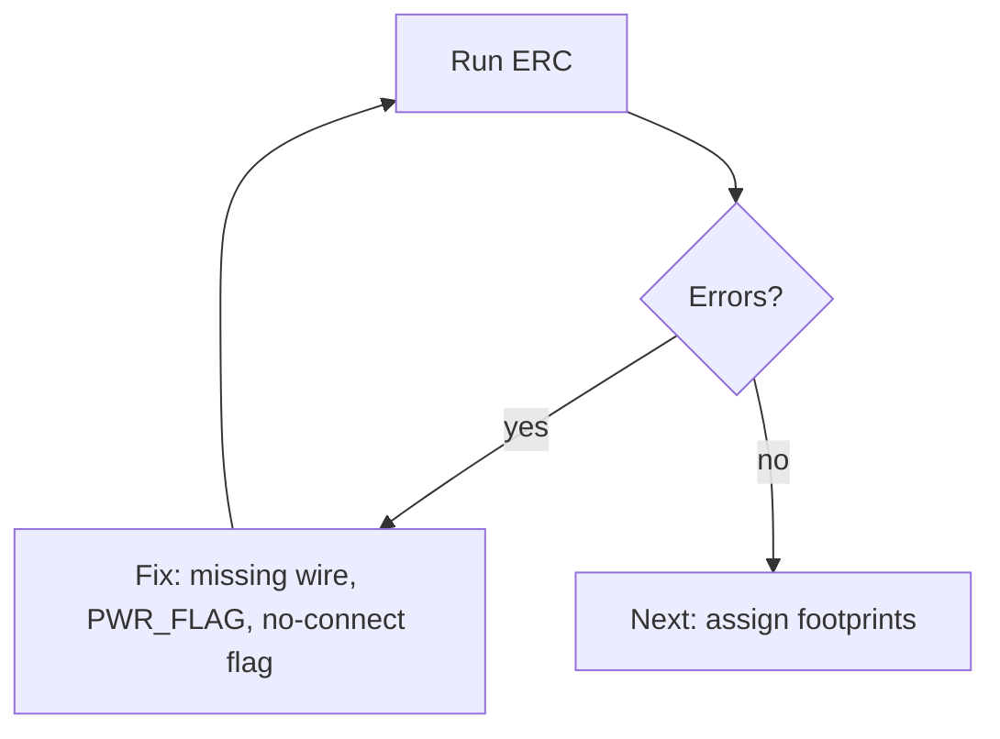

# Drawing the schematic

We'll design one board through this course: the **555 LED flasher** from the electronics course, powered by a 9 V battery or a 5 V USB supply. Build it on a breadboard first if you can; a board that copies a working prototype is far more likely to work first time.

## Placing symbols

In the Schematic Editor press **A** and search:

| Symbol name in KiCad | Part |
|---|---|
| `NE555P` (Timer library) | 555 timer, DIP-8 |
| `R` | resistor (×3) |
| `C` | capacitor (10 nF) |
| `C_Polarized` | 10 µF electrolytic |
| `LED` | LED |
| `Conn_01x02` | 2-pin connector for power |
| `+9V`, `GND` (power symbols) | supply and ground labels |

Place them roughly where they are in the drawing. Press **R** to rotate, **M** to move.

## Wiring

Press **W**, click on a pin end, click on the other pin. A green dot shows a junction (three or more wires joining). Tips:

- Wires connect only at **pin ends** and **junction dots**. Crossing wires without a dot are not connected.
- Use **power symbols** (`+9V`, `GND`) instead of long wires: every `GND` symbol is the same net, wherever it is on the sheet.
- Use **net labels** (press **L**) to name signals like `OUT` or `TRIG`: two labels with the same name are connected. They keep big schematics readable.

## Annotate and set values

1. **Annotate** (Tools → Annotate Schematic): KiCad numbers the parts R1, R2, C1...
2. Set each part's **value**: hover and press **V**. R1 = 1k, R2 = 68k, R3 = 470, C1 = 10µ, C2 = 10n.

Good schematics read left to right (inputs to outputs) with power at the top and ground at the bottom, just like the drawing above.

## Power flags and the ERC

Run the **Electrical Rules Check** (Inspect → Electrical Rules Checker). It catches:

- pins left unconnected by mistake
- outputs connected to outputs
- "power input pin not driven": KiCad doesn't know your +9V comes from the connector

Fix the last one by placing a **PWR_FLAG** symbol on the +9V and GND nets. It tells KiCad "power enters here". Mark pins you really want unconnected with the **no-connect flag** (Q).

Don't move on until the ERC is clean, or you understand and accept every warning.

## Add the decoupling capacitor

The breadboard version may have worked without it, but every chip on a PCB gets a **100 nF** capacitor between its VCC and GND pins. Add C3 = 100n now. On the board you'll place it right next to the 555's pin 8.

## Summary

- Place symbols with A, wire with W; use power symbols and net labels instead of long wires.
- Annotate, set values, add PWR_FLAGs, and run the ERC until it's clean.
- Add a 100 nF decoupling capacitor for every chip, even if the breadboard worked without one.

## Optional videos

The lesson above is complete on its own. These videos go deeper, if you like learning by watching.

**KiCad 9.0 getting started, part 2: schematic layout (DigiKey)**

https://www.youtube.com/watch?v=0Q6gU7-QqUg

**KiCad 9.0 getting started, part 3: create a custom schematic symbol (DigiKey)**

https://www.youtube.com/watch?v=0MqHR6cU_y0
