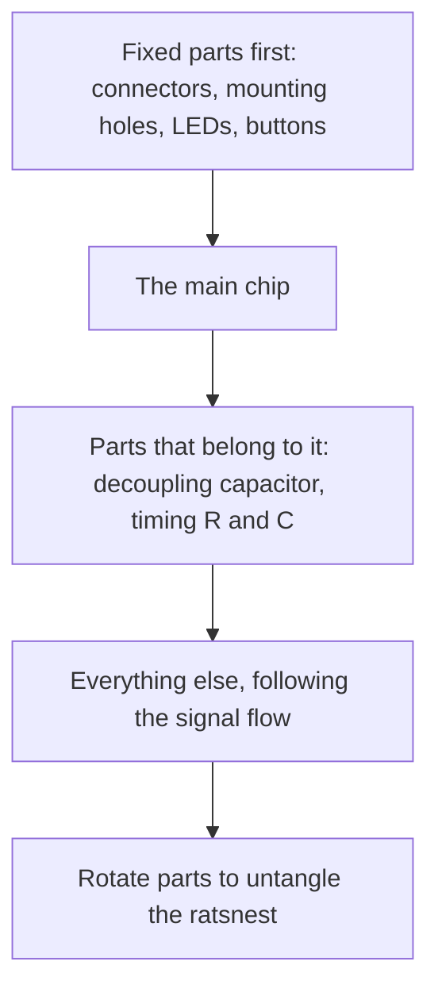

# Board layout: outline and placement

Open the **PCB Editor** and press **F8** (Tools → Update PCB from Schematic). All the footprints appear in a pile, joined by thin lines called the **ratsnest**: each line shows a connection you still have to make with copper.

## The board outline

Draw the board's shape on the **Edge.Cuts** layer: select Edge.Cuts in the layers panel, then draw a rectangle (rounded corners look and feel nicer). For this flasher, 30 × 25 mm is plenty.

Think about the case first: where do the mounting holes go (M3 screws are common; footprint `MountingHole:MountingHole_3.2mm_M3`), and which edge must the power connector face?

## Placement matters most

Good placement makes routing easy; bad placement makes it impossible. A good order:

Rules of thumb:

- **Decoupling capacitors** go as close as possible to the power pin they serve (C3 right beside pin 8 of the 555).
- Keep parts that connect to each other **close together**, and follow the signal: input on one side, output on the other.
- Line parts up in the same direction. It's easier to check, assemble and solder.
- Leave room around connectors for fingers and plugs.
- Watch the ratsnest: when lines cross a lot, rotate (**R**) or move parts until they mostly run straight.

## Courtyards

Each footprint has a **courtyard** (a thin outline on the F.Courtyard layer): the space the part needs, including room for soldering. Courtyards shouldn't overlap. KiCad's design rule check will flag overlaps later.

## Silkscreen

Make the silkscreen useful:

- Reference designators (R1, C3) readable, not under parts, all the same orientation.
- Mark **+** and **−** at the power connector, pin 1 of chips, and the LED's polarity.
- Add the board name, version and date (for example `LED flasher v1.0 2026-11`). When you have three versions on your desk, you'll be glad.

## Check in 3D

**View → 3D Viewer** (Alt+3) shows the board with real-looking parts. It's the quickest way to spot a part facing the wrong way, a connector hanging off the edge, or a tall capacitor where the lid will go.

## Summary

- Update the PCB from the schematic (F8); draw the outline on Edge.Cuts with the case in mind.
- Place fixed parts first, then the chip, its decoupling capacitor, then the rest along the signal flow.
- Keep courtyards apart, make the silkscreen helpful, and check everything in the 3D viewer.

## Optional videos

The lesson above is complete on its own. These videos go deeper, if you like learning by watching.

**KiCad 9.0 getting started, part 6: laying out your first PCB (DigiKey)**

https://www.youtube.com/watch?v=zdieFtrvjew
