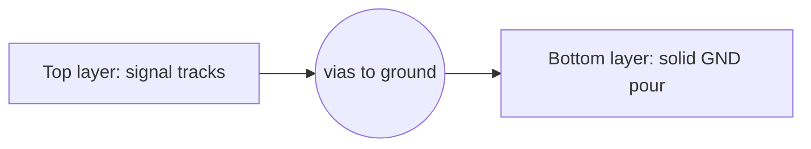

# Routing: tracks, vias and ground

Now turn every ratsnest line into copper. Press **X** to start a track from a pad, click to make corners, and finish on the target pad. KiCad keeps tracks a safe distance from everything else automatically.

## Track width

Tracks carrying more current must be wider, or they heat up. The IPC-2221 standard gives a formula for the minimum width. KiCad's **Calculator Tools → Track Width** does it for you; here it is in Python so you can see what drives it:

```python
def track_width_mm(current_a, temp_rise_c=10, copper_oz=1.0, outer=True):
    k = 0.048 if outer else 0.024
    area_mils2 = (current_a / (k * temp_rise_c ** 0.44)) ** (1 / 0.725)
    thickness_mils = 1.378 * copper_oz
    return area_mils2 / thickness_mils * 0.0254

for amps in [0.1, 0.5, 1, 2, 3]:
    print(f"{amps:>4} A -> at least {track_width_mm(amps):.2f} mm")
```

```output
 0.1 A -> at least 0.01 mm
 0.5 A -> at least 0.12 mm
   1 A -> at least 0.30 mm
   2 A -> at least 0.78 mm
   3 A -> at least 1.37 mm
```

Practical defaults for small boards:

- **Signals**: 0.25 mm (no real current).
- **Power** up to about 1 A: 0.5 mm or more.
- Wider is free when there's room: use it for power and ground.

Set these as **net classes** (Board Setup → Net Classes): a "Power" class with 0.5 mm tracks for +9V and GND, and the default 0.25 mm for everything else. Then KiCad picks the right width as you route.

## Good routing habits

- Route **power and ground first**, then the sensitive or short connections, then the rest.
- Use **45° corners**, not 90° (press `/` while routing to switch the corner style). They're shorter and look cleaner.
- On 2-layer boards, a common style: top layer mostly horizontal tracks, bottom mostly vertical, joined by **vias** where needed (press **V** while routing to drop a via and switch layers).
- Keep the loop from the decoupling capacitor to the chip **short**: capacitor pad → chip VCC pin, and capacitor ground → chip GND pin, as directly as possible.

## Ground pour

Instead of routing every ground connection as a track, fill the empty space on the bottom layer (or both) with copper connected to GND: a **ground pour** (zone).

1. Select the **B.Cu** layer, then **Place → Zone** (Ctrl+Shift+Z).
2. Choose the **GND** net, and draw the zone around the whole board.
3. Press **B** to fill zones. Every GND pad on that layer now connects automatically.



Benefits: less routing, lower noise, a short return path for every signal, and better heat spreading. Add a few extra vias joining top and bottom ground areas ("stitching") so no island of copper is left floating.

## Thermal reliefs

Pads connected to a ground pour get small spokes instead of a solid connection: **thermal reliefs**. Without them, the big copper area soaks up the soldering iron's heat and the joint won't form. KiCad adds them by default; leave them on.

## When you're stuck

If a track can't get through: move or rotate a part, go to the other layer with a via, or route around. If many tracks are stuck, go back to placement: routing problems are almost always placement problems.

## Summary

- Route with X; size tracks for their current (0.25 mm signals, 0.5 mm+ power) using net classes.
- 45° corners, vias to change layers, short decoupling loops, power and ground first.
- Fill a GND pour on the bottom layer (B fills zones); keep thermal reliefs; fix stuck routes by re-placing.

## Optional videos

The lesson above is complete on its own. These videos go deeper, if you like learning by watching.

**KiCad 9.0 getting started, part 6: laying out your first PCB (DigiKey)**

https://www.youtube.com/watch?v=zdieFtrvjew

**2-layer PCB design tips (Phil's Lab)**

https://www.youtube.com/watch?v=M6_an34wQJk
