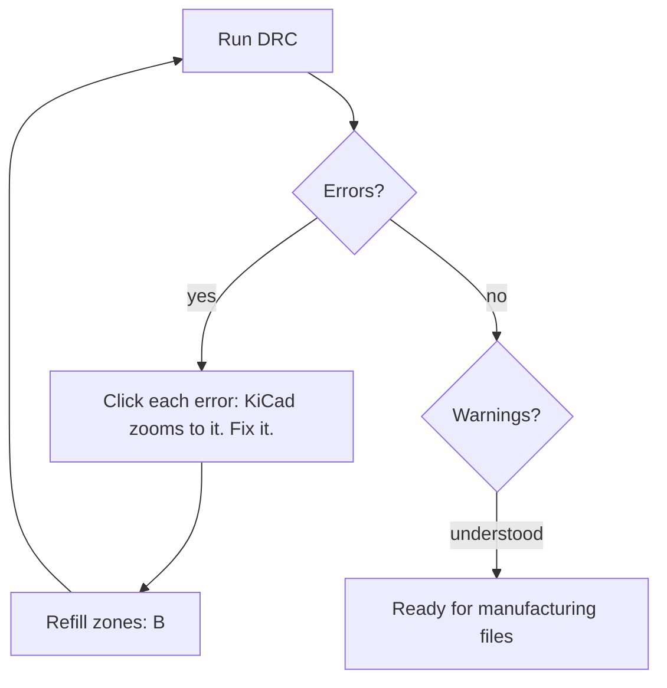

# Design rules and the DRC

Every PCB factory has limits: how thin a track it can make, how close two tracks can be, how small a hole it can drill. Design within those limits and your boards come back right.

## Typical limits for cheap, standard boards

| Rule | Typical standard limit | A safe choice for beginners |
|---|---|---|
| Minimum track width | 0.127 mm (5 mil) | 0.2 to 0.25 mm |
| Minimum clearance (track to track) | 0.127 mm | 0.2 mm |
| Minimum via drill | 0.3 mm | 0.4 mm drill, 0.8 mm pad |
| Minimum hole size | 0.3 mm | match the part's lead + 0.2 to 0.4 mm |
| Copper to board edge | 0.3 mm | 0.5 mm |
| Silkscreen text height | 0.8 to 1 mm | 1 mm |

These differ between manufacturers and change over time. Before ordering, look up your chosen factory's **capabilities** page and use its numbers. (A "mil" is a thousandth of an inch: 0.0254 mm.)

## Setting the rules in KiCad

**File → Board Setup → Design Rules → Constraints**: enter the minimum track width, clearance, via size and hole size. Some factories publish a ready-made KiCad rules file or a board template you can import. KiCad 10 also has a graphical editor for custom rules, for example "keep 2 mm between the mains part of a board and the low-voltage part".

## Running the DRC

**Inspect → Design Rules Checker** (DRC) compares the board with the rules and the schematic. It reports:

- **Unrouted nets**: a ratsnest line you forgot.
- **Clearance violations**: copper too close.
- **Track width** below the minimum.
- **Courtyard overlaps**: parts too close to assemble.
- **Silkscreen over pads**: text that would be cut off.
- **Schematic and board out of sync**: you changed the schematic but didn't update the PCB (F8).

Refill zones (**B**) before every DRC: an old ground pour can hide or cause errors.

## A final human check

The DRC catches rule breaks, not design mistakes. Before ordering, check yourself:

1. **Print the board 1:1 on paper** and press the real parts onto it. Wrong footprints show up immediately.
2. Pin 1 of every chip and the polarity of every LED, diode and electrolytic capacitor.
3. Connectors: is the + / − order what your cable or battery expects?
4. Every chip has its decoupling capacitor close to its power pin.
5. Mounting holes line up with the case.
6. Board name and version on the silkscreen.

Ten minutes here saves two weeks of waiting for boards that don't work.

## Summary

- Factories publish limits; set them in Board Setup, using safe values (0.2 to 0.25 mm tracks and clearances).
- Run the DRC until clean, refilling zones first; fix "out of sync" with F8.
- Do a human check: a 1:1 printout, polarities, pin 1, connectors, decoupling.

## Optional videos

The lesson above is complete on its own. These videos go deeper, if you like learning by watching.

**2-layer PCB design tips (Phil's Lab)**

https://www.youtube.com/watch?v=M6_an34wQJk
