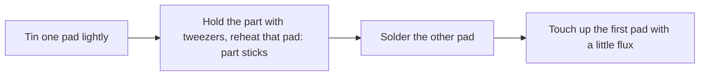

# Soldering and bringing a board to life

The boards arrived. Now: solder the parts, and power the board up carefully.

## Tools

| Tool | Notes |
|---|---|
| Temperature-controlled soldering iron | 320 to 350 °C for lead-free solder; a chisel tip 1.5 to 2 mm |
| Solder wire with flux core | 0.5 to 0.8 mm diameter |
| Extra **flux** (pen or gel) | the secret to good SMD joints |
| Fine **tweezers** | for SMD parts |
| Solder wick (braid) | removes excess solder |
| Magnifier or phone camera | to inspect joints |
| Fume extraction or an open window | flux smoke is irritating; don't breathe it |

Safety: the iron is hot enough to burn instantly, so always return it to its stand. Wash your hands after soldering, especially with leaded solder.

## Soldering order

Solder the **lowest parts first** (SMD resistors and capacitors), then the chip, then taller through-hole parts (connectors, electrolytic capacitor). The board then rests flat while you work.

### An SMD resistor (0805)



### A through-hole part

1. Insert the part, bend the legs slightly so it stays put.
2. Touch the iron to **both** the pad and the leg for 1 to 2 seconds.
3. Feed solder into the joint (not onto the iron). It should flow around and form a shiny cone.
4. Remove the solder, then the iron. Clip the leg.

A good joint is smooth and shaped like a small volcano. A ball sitting on top, or a dull grainy joint, means not enough heat: add flux and reheat.

## Bring-up: power on safely

Never just connect power and hope. Follow a routine:

1. **Look**: check every chip's pin 1, every LED, diode and electrolytic capacitor's polarity, and look for solder bridges between pins.
2. **Measure resistance** between the supply pins (power off): it should **not** be near 0 Ω. A short here means a bridge or a reversed part.
3. **Current-limited power**: use a bench supply with the current limit set low (for example 50 mA), or put a 100 Ω resistor in series the first time. A fault then gets warm instead of burning.
4. **Measure voltages**: VCC at the chip's power pin, the outputs. Compare with what you expect.
5. **Then** test the function: does the LED blink at about 1 Hz?

```python
measured = {"VCC at U1 pin 8": 8.9, "C1 voltage (swinging)": "3.0 to 6.0", "blink rate (Hz)": 1.1}
expected = {"VCC at U1 pin 8": "about 9", "C1 voltage (swinging)": "1/3 to 2/3 of VCC", "blink rate (Hz)": "about 1.05"}
for k in measured:
    print(f"{k:24} measured {str(measured[k]):11} expected {expected[k]}")
```

```output
VCC at U1 pin 8          measured 8.9         expected about 9
C1 voltage (swinging)    measured 3.0 to 6.0  expected 1/3 to 2/3 of VCC
blink rate (Hz)          measured 1.1         expected about 1.05
```

Keep a small table like this in your project notes for every board.

## When it doesn't work

- **Nothing at all**: power not reaching the chip. Measure at the connector, then at the chip's VCC pin. Check for a reversed connector.
- **Gets hot**: power off immediately. Look for a short, a reversed electrolytic or a chip in backwards.
- **Works sometimes**: a bad solder joint. Reheat suspicious joints with fresh flux.
- **Wrong behaviour**: compare the board with the schematic net by net, with the multimeter's continuity beep.

Note every problem and its fix in `notes.md`, then correct the design for **v1.1**. Almost every real board goes through a second version.

## Summary

- Temperature-controlled iron, flux, tweezers; solder lowest parts first; heat pad and leg together.
- Bring-up: inspect, check for shorts, power with a current limit, measure, then test the function.
- Record measurements and fixes; plan a v1.1 for whatever you learn.

## Optional videos

The lesson above is complete on its own. These videos go deeper, if you like learning by watching.

**Soldering tutorial, part 1: tools (EEVblog)**

https://www.youtube.com/watch?v=J5Sb21qbpEQ

**Soldering tutorial, part 3: surface mount (EEVblog)**

https://www.youtube.com/watch?v=b9FC9fAlfQE
