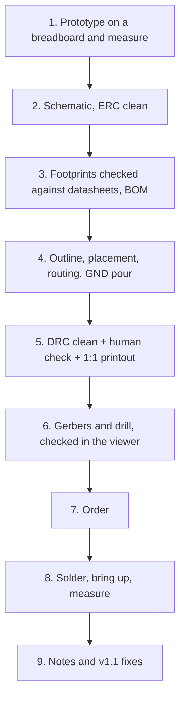

# Project: your own LED flasher board, start to finish

Time to do the whole journey yourself with the 555 flasher, then a second board of your choice.

## The checklist

Work through it in order, ticking each step. It's the same list professionals use, just shorter.

### 1. Prototype

Build the flasher from the electronics course on a breadboard, with R1 = 1 kΩ, R2 = 68 kΩ, C1 = 10 µF. Measure the blink rate. Decide how you'll power it: a 9 V battery clip or a USB 5 V connector (the 555 works from 4.5 to 16 V).

### 2. Schematic

Symbols, wires, power symbols, PWR_FLAGs, decoupling capacitor, annotation, values, ERC clean. Add a second LED on the output through its own resistor, so the board looks better.

### 3. Footprints and BOM

0805 for resistors and small capacitors, radial for the electrolytic, DIP-8 or SOIC-8 for the 555, a 2-pin header or USB connector for power. Check each against its datasheet. Generate the BOM.

### 4. Layout

- Board about 35 × 25 mm, rounded corners, two M3 mounting holes.
- Power connector on an edge; LEDs where they'll be seen.
- C3 (100 nF) right next to pin 8 of the 555.
- Power tracks 0.5 mm, signals 0.25 mm; GND pour on the bottom.
- Silkscreen: + and −, LED polarity, board name, version, date, your name.

### 5. Checks

DRC clean, the 3D view looks right, and a printout matches the real parts.

### 6 and 7. Files and order

Gerbers and drill files, zipped and checked in the Gerber viewer. Order 5 boards.

### 8. Build and test

Solder lowest parts first, inspect, check for shorts, current-limited power-up, measure VCC and the blink rate, and fill in your measurement table.

### 9. Notes

Write what you'd change. Even a working board usually has a v1.1 list: a label in a better place, a bigger pad, a different connector.

## Your second board

Pick one and design it the same way:

1. **The night light** from the electronics course: LDR, potentiometer, transistor and three LEDs.
2. A **USB-powered LED desk lamp** with a MOSFET and a button.
3. A **breakout board**: put a small SMD sensor chip onto a board with 2.54 mm pins, so you can use it on a breadboard.

## Sharing your design

Put the KiCad project, Gerbers, BOM and photos in a GitHub repository with a short README. Other people can order your board directly from your files, and it's a strong addition to a portfolio.

## Where to go next

Next in the electronics path: **Microcontroller PCB design**, where you design a complete board around an ATmega328P (the chip in the Arduino Uno), with USB power, programming headers and your own sensors, and then program it.

## Summary

- Follow the checklist: prototype, schematic, footprints, layout, checks, files, order, build, notes.
- Design a second board yourself to make the process stick.
- Share the project (KiCad files, Gerbers, BOM, README) so anyone can build it.

## Optional videos

The lesson above is complete on its own. These videos go deeper, if you like learning by watching.

**KiCad 9.0 getting started, part 6: laying out your first PCB (DigiKey)**

https://www.youtube.com/watch?v=zdieFtrvjew

**Astable 555 timer (Ben Eater)**

https://www.youtube.com/watch?v=kRlSFm519Bo
