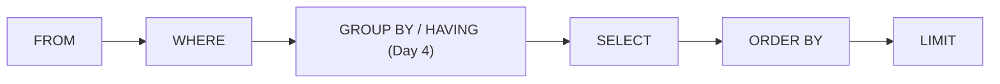

# SELECT: filtering, sorting and limiting

```sql
SELECT first_name, email FROM customers;           -- chosen columns
SELECT * FROM customers;                           -- all columns (fine for exploring, avoid in apps)
SELECT DISTINCT country_code FROM customers;       -- unique values
```

## WHERE: which rows

```sql
SELECT * FROM customers
WHERE country_code = 'EG'
  AND birth_date >= '1995-01-01'
  AND (first_name = 'Sara' OR first_name = 'Omar');
```

| Operator | Means |
|---|---|
| `=`, `<>` (or `!=`) | Equal, not equal |
| `<`, `<=`, `>`, `>=` | Comparisons (numbers, dates, text) |
| `AND`, `OR`, `NOT` | Combine; use brackets to be clear |

## ORDER BY and LIMIT

```sql
SELECT first_name, created_at FROM customers
ORDER BY created_at DESC, first_name ASC
LIMIT 10;

-- page 3 of 10-per-page results:
SELECT * FROM customers ORDER BY id LIMIT 10 OFFSET 20;
-- the SQL-standard spelling:
SELECT * FROM customers ORDER BY id OFFSET 20 ROWS FETCH FIRST 10 ROWS ONLY;
```

- Without `ORDER BY`, row order is **not guaranteed**, even if it looks stable.
- `OFFSET` gets slow on deep pages (it still reads the skipped rows). The advanced course shows "keyset" pagination.

## The order SQL runs in

You write `SELECT ... FROM ... WHERE ... ORDER BY ... LIMIT`, but Postgres works in this order:



That's why you can't use a column alias from SELECT inside WHERE, but you can in ORDER BY.

## Optional videos

The lesson above is complete on its own. These go deeper, if you like learning by watching.

**Amigoscode PostgreSQL course: select, order by, distinct, where, comparison operators, limit**

https://www.youtube.com/watch?v=qw--VYLpxG4&t=4348&end=5563
