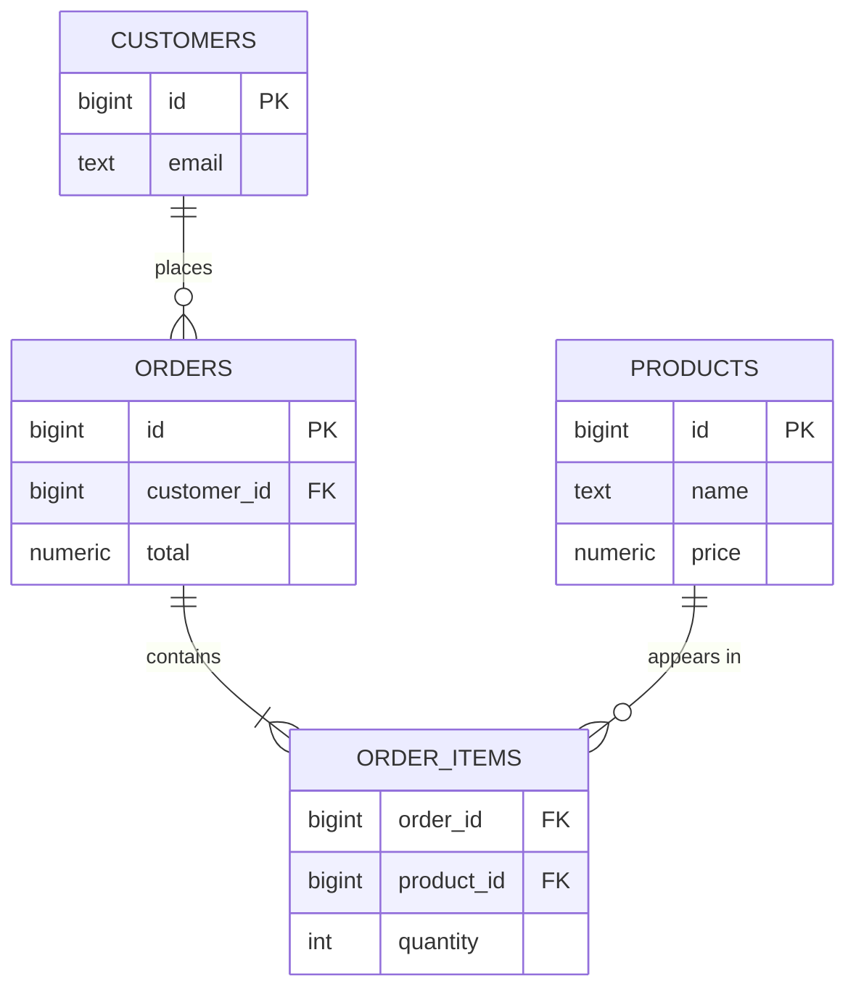

# Relationships and foreign keys

## One-to-many

One customer has many orders. Store the customer's id **in each order**:

```sql
ALTER TABLE orders
  ADD CONSTRAINT orders_customer_fk
  FOREIGN KEY (customer_id) REFERENCES customers (id);
```

Now Postgres refuses an order for a customer that doesn't exist, and refuses deleting a customer who still has orders (by default).



## Many-to-many

An order has many products; a product is in many orders. A **join table** (`order_items`) holds the pairs, plus facts about the pair (quantity, price at the time).

```sql
CREATE TABLE products (id bigint GENERATED ALWAYS AS IDENTITY PRIMARY KEY, name text NOT NULL, price numeric(10,2) NOT NULL);
CREATE TABLE order_items (
    order_id   bigint NOT NULL REFERENCES orders (id) ON DELETE CASCADE,
    product_id bigint NOT NULL REFERENCES products (id),
    quantity   int    NOT NULL CHECK (quantity > 0),
    unit_price numeric(10,2) NOT NULL,
    PRIMARY KEY (order_id, product_id)
);
```

## ON DELETE choices

| Option | When the parent row is deleted |
|---|---|
| (default) `NO ACTION` / `RESTRICT` | Refuse while children exist |
| `CASCADE` | Delete the children too (order items with their order) |
| `SET NULL` | Keep children, clear the reference |

Use `CASCADE` only where children truly belong to the parent.

## Normalization in one line

Store each fact **once**. A customer's email lives in `customers`, not copied into every order. Copies drift apart; references don't.

Index your foreign key columns (`CREATE INDEX ON orders (customer_id);`): Postgres doesn't do it automatically, and joins and deletes need it.

## Optional videos

The lesson above is complete on its own. These go deeper, if you like learning by watching.

**Amigoscode PostgreSQL course: relationships and foreign keys**

https://www.youtube.com/watch?v=qw--VYLpxG4&t=11801&end=12570
