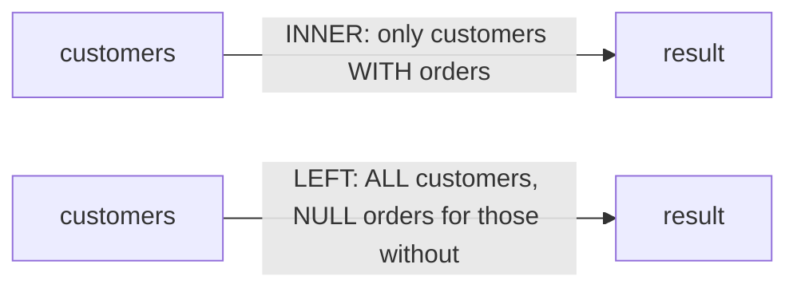

# JOINs

A join combines rows from tables that are related.

```sql
SELECT o.id, o.total, c.first_name, c.email
FROM orders o
JOIN customers c ON c.id = o.customer_id
WHERE o.status = 'paid'
ORDER BY o.total DESC
LIMIT 10;
```

`o` and `c` are table aliases: shorter, and required when column names repeat.

## Kinds of joins

| Join | Keeps |
|---|---|
| `JOIN` (INNER) | Only rows with a match on both sides |
| `LEFT JOIN` | Every row from the left table; NULLs where the right has no match |
| `RIGHT JOIN` | The mirror image (rarely used; flip the tables instead) |
| `FULL JOIN` | Everything from both sides |



## Classic questions

```sql
-- customers who never ordered (LEFT JOIN + IS NULL)
SELECT c.id, c.email
FROM customers c
LEFT JOIN orders o ON o.customer_id = c.id
WHERE o.id IS NULL;

-- revenue per country
SELECT c.country_code, count(o.id) AS orders, sum(o.total) AS revenue
FROM customers c
JOIN orders o ON o.customer_id = c.id
GROUP BY c.country_code
ORDER BY revenue DESC NULLS LAST;

-- three tables: what was in order 42?
SELECT p.name, oi.quantity, oi.unit_price
FROM order_items oi
JOIN products p ON p.id = oi.product_id
WHERE oi.order_id = 42;
```

## The join mistake that doubles your numbers

Joining a customer to orders **and** to reviews in one query multiplies rows (each order paired with each review), so sums come out too big. Aggregate each side first (in a subquery or a CTE: `WITH order_totals AS (...)`), then join the results.

Always sanity-check a join with `count(*)` before and after.

## Optional videos

The lesson above is complete on its own. These go deeper, if you like learning by watching.

**Amigoscode PostgreSQL course: inner and left joins, deleting with foreign keys**

https://www.youtube.com/watch?v=qw--VYLpxG4&t=12570&end=13647
