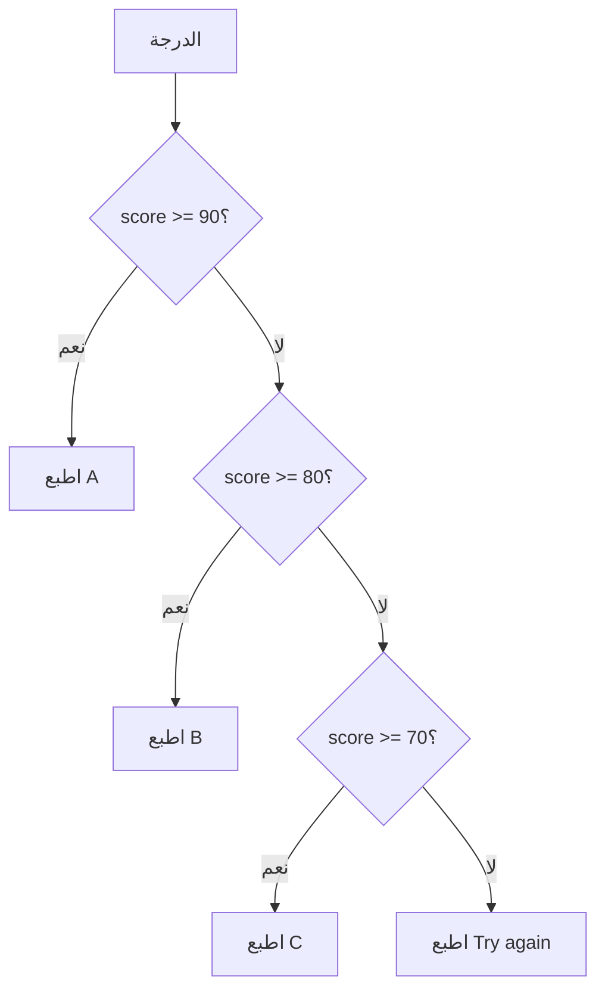

# if وelif وelse

يتخذ البرنامج قراراته بـ `if`. والأسطر المزاحة تحتها لا تُنفَّذ إلا إذا كان الشرط `True`.

> **فيديو اختياري في الأعلى.** محاضرة هارفارد الكاملة لهذا الأسبوع (56 دقيقة)، يقدّمها ديفيد مالان، وتغطي هذه الوحدة. وملاحظات هارفارد المكتوبة (بالإنجليزية): [ملاحظات CS50P، الأسبوع 1](https://cs50.harvard.edu/python/notes/1/). كل ما تحتاجه موجود في النص أدناه، فشاهده فقط إن كان يفيدك: يحفظ inPace المكان الذي توقفت عنده.
>
> الفيديو بالإنجليزية: إن أردت مشاهدته فشغّل الترجمة (**CC**)، ثم **الإعدادات ← الترجمة ← ترجمة تلقائية ← العربية**.

```python
score = int(input("Score: "))

if score >= 90:
    print("A")
elif score >= 80:
    print("B")
elif score >= 70:
    print("C")
else:
    print("Try again next time")
```



تفحص بايثون الشروط **بالترتيب** وتتوقف عند أول شرط صحيح. لذلك تطبع الدرجة 95 الحرف `A` وحده، مع أن 95 أكبر من 80 أيضًا.

## المقارنة والدمج

| اكتب | المعنى |
|---|---|
| `==` | يساوي (علامة `=` واحدة تخزّن قيمة، واثنتان تقارنان) |
| `!=` | لا يساوي |
| `and` | يجب أن يتحقق الشرطان |
| `or` | يكفي أن يتحقق أحدهما |
| `not` | تعكس الصحيح والخطأ |

```python
if 0 <= score <= 100:          # Python lets you chain comparisons
    print("valid")
if day == "Friday" or day == "Saturday":
    print("weekend")
```

## الإزاحة جزء من القواعد

تعرف بايثون أي الأسطر تتبع `if` من إزاحتها (4 مسافات). ونسيان النقطتين `:` أو إزاحة سطر خطأً هو أكثر أخطاء المبتدئين: اقرأ رقم السطر في رسالة الخطأ.
