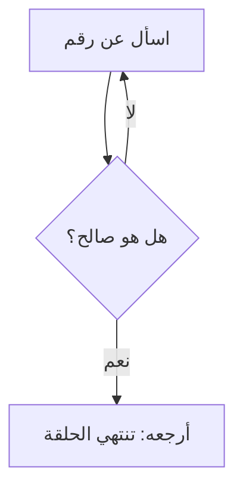

# while وfor

**الحلقة** تشغّل الأسطر نفسها مرات كثيرة. تكرر `while` ما دام الشرط صحيحًا، وتمر `for` على سلسلة عنصرًا بعد عنصر.

> **فيديو اختياري في الأعلى.** محاضرة هارفارد الكاملة لهذا الأسبوع (ساعة و21 دقيقة)، يقدّمها ديفيد مالان، وتغطي هذه الوحدة. وملاحظات هارفارد المكتوبة (بالإنجليزية): [ملاحظات CS50P، الأسبوع 2](https://cs50.harvard.edu/python/notes/2/). كل ما تحتاجه موجود في النص أدناه، فشاهده فقط إن كان يفيدك: يحفظ inPace المكان الذي توقفت عنده.
>
> الفيديو بالإنجليزية: إن أردت مشاهدته فشغّل الترجمة (**CC**)، ثم **الإعدادات ← الترجمة ← ترجمة تلقائية ← العربية**.

```python
count = 3
while count > 0:
    print(count)
    count -= 1        # forget this line and the loop never ends
print("Go!")

for i in range(3):    # 0, 1, 2
    print("step", i)
```

## السؤال حتى تصح الإجابة

تدور `while True` إلى الأبد، وتخرج `break` من الحلقة. ومعًا هما الطريقة المعتادة للتحقق من المدخلات. أما `continue` فتقفز إلى الدورة التالية.



```python
def get_positive():
    while True:
        n = int(input("How many? "))
        if n > 0:
            return n        # return also leaves the loop (and the function)
```

## range بالتفصيل

تعطي `range(5)` من 0 إلى 4، وتعطي `range(1, 6)` من 1 إلى 5، وتعطي `range(0, 10, 2)` الأعداد 0 و2 و4 و6 و8. ولا يدخل رقم النهاية أبدًا.
