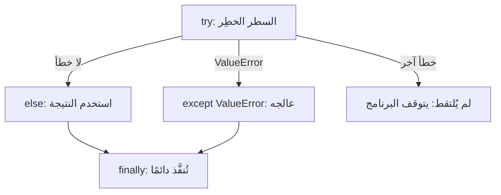

# الأخطاء وtry/except

بعض الأخطاء تمنع بايثون من البدء أصلًا (مثل `SyntaxError`: علامة اقتباس أو نقطتان ناقصة). وبعضها يحدث أثناء التشغيل بسبب البيانات التي يتلقاها البرنامج، وهذه هي **الاستثناءات**، ويمكنك التقاطها.

> **فيديو اختياري في الأعلى.** محاضرة هارفارد الكاملة لهذا الأسبوع (45 دقيقة)، يقدّمها ديفيد مالان، وتغطي هذه الوحدة. وملاحظات هارفارد المكتوبة (بالإنجليزية): [ملاحظات CS50P، الأسبوع 3](https://cs50.harvard.edu/python/notes/3/). كل ما تحتاجه موجود في النص أدناه، فشاهده فقط إن كان يفيدك: يحفظ inPace المكان الذي توقفت عنده.
>
> الفيديو بالإنجليزية: إن أردت مشاهدته فشغّل الترجمة (**CC**)، ثم **الإعدادات ← الترجمة ← ترجمة تلقائية ← العربية**.

```python
try:
    age = int(input("Age: "))
except ValueError:
    print("Please type a whole number")
else:
    print(f"Next year you'll be {age + 1}")
```



## اقرأ رسالة الخطأ من الأسفل

حين يتعطل البرنامج تطبع بايثون **مسار الخطأ** (traceback). آخر سطر يذكر نوع الخطأ وما الذي حدث، والسطر الذي فوقه يذكر مكانه. ومن أشهرها:

| الخطأ | معناه غالبًا |
|---|---|
| `ValueError` | النوع صحيح لكن القيمة لا تصلح: `int("cat")` |
| `TypeError` | النوع خطأ: `"1" + 1` |
| `NameError` | متغير غير موجود (غالبًا خطأ إملائي) |
| `KeyError` | مفتاح غير موجود في القاموس |
| `IndexError` | موضع بعد نهاية القائمة |
| `ZeroDivisionError` | القسمة على صفر |

## التقط ما تتوقعه فقط

اكتب `except ValueError:` لا `except:` وحدها. فالـ except المجردة تخفي أخطاءك أنت أيضًا، بل تخفي Ctrl+C.
