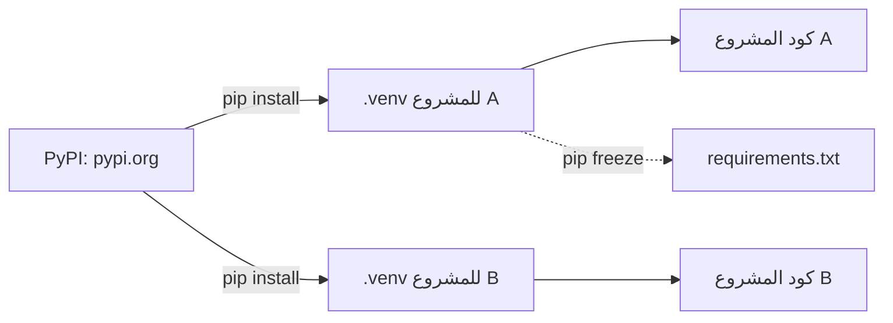

# الحزم وpip والبيئات الافتراضية

الكود الذي يشاركه الآخرون موجود على [PyPI](https://pypi.org)، ويثبّته `pip`. واجعل لكل مشروع **بيئة افتراضية** خاصة به كي لا تتعارض حزم المشاريع المختلفة:

```bash
python -m venv .venv               # once per project
.venv\Scripts\activate             # Windows
source .venv/bin/activate          # Mac and Linux
pip install requests
pip freeze > requirements.txt      # remember the exact versions
```



## استدعاء واجهة ويب

كثير من المواقع تجيب بـ **JSON**، وهو نص يشبه قواميس بايثون وقوائمها. تنزّله `requests` وتحوّله `.json()` إلى قيم بايثون:

```python
import requests

response = requests.get("https://api.github.com/repos/python/cpython")
data = response.json()
print(data["stargazers_count"], "stars")
```

الحزمة التي تثبّتها ليست داخل ملفك، فمن يشغّل كودك يحتاجها أيضًا: ولهذا يوجد `requirements.txt` (`pip install -r requirements.txt`).

اقرأ المزيد عن الحزم في [موسوعة حسوب](https://wiki.hsoub.com/Python)، وعن البيئات الافتراضية في توثيق بايثون الرسمي: [venv](https://docs.python.org/3/tutorial/venv.html) (بالإنجليزية).
