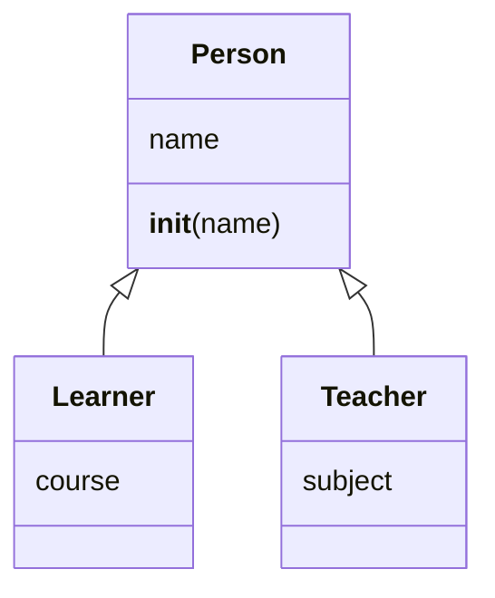

# الوراثة والتوابع الخاصة

يمكن أن **يرث** صنف من آخر: فيأخذ كل توابع الأب ويضيف بعضها أو يغيّره. وتستدعي `super()` نسخة الأب:

```python
class Person:
    def __init__(self, name):
        if not name:
            raise ValueError("Missing name")
        self.name = name


class Learner(Person):
    def __init__(self, name, course):
        super().__init__(name)
        self.course = course


class Teacher(Person):
    def __init__(self, name, subject):
        super().__init__(name)
        self.subject = subject
```



## التوابع الخاصة

التوابع التي تحيط بها شرطتان سفليتان من كل جانب تجعل كائناتك تعمل مع عمليات بايثون ودوالها:

```python
class Money:
    def __init__(self, pounds=0):
        self.pounds = pounds

    def __add__(self, other):          # makes  a + b  work
        return Money(self.pounds + other.pounds)

    def __eq__(self, other):           # makes  a == b  compare values
        return self.pounds == other.pounds

    def __str__(self):
        return f"{self.pounds} EGP"


print(Money(100) + Money(50))     # 150 EGP
```
