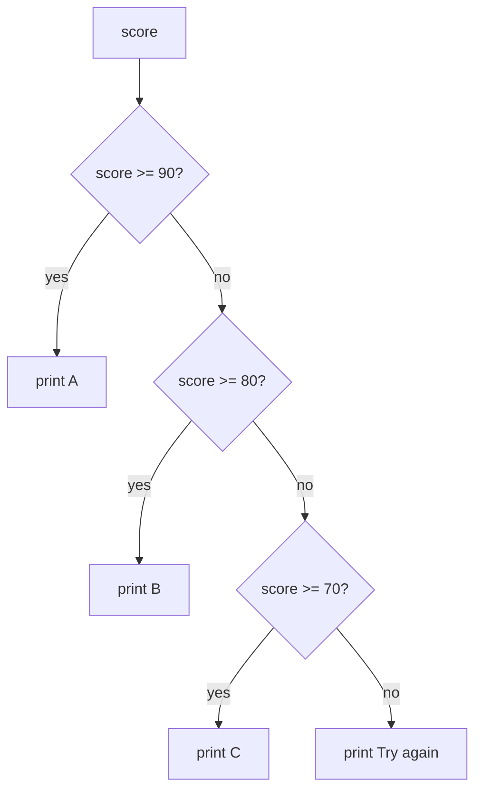

# if, elif and else

A program makes decisions with `if`. The indented lines under it run only when the condition is `True`.

> **Optional video above.** Harvard's whole lecture for this week (56 min), by David J. Malan, covering this module. Harvard's own written notes: [CS50P notes, week 1](https://cs50.harvard.edu/python/notes/1/). Everything you need is in the text below, so watch it only if it helps you: inPace remembers where you stopped.

```python
score = int(input("Score: "))

if score >= 90:
    print("A")
elif score >= 80:
    print("B")
elif score >= 70:
    print("C")
else:
    print("Try again next time")
```



Python checks the conditions **in order** and stops at the first true one. So a score of 95 prints only `A`, even though 95 is also `>= 80`.

## Comparing and combining

| Write | Means |
|---|---|
| `==` | equal (one `=` stores a value, two compare) |
| `!=` | not equal |
| `and` | both must be true |
| `or` | at least one must be true |
| `not` | flips true and false |

```python
if 0 <= score <= 100:          # Python lets you chain comparisons
    print("valid")
if day == "Friday" or day == "Saturday":
    print("weekend")
```

## Indentation is the syntax

Python knows which lines belong to the `if` by their indentation (4 spaces). A missing colon `:` or a line indented wrongly is the most common beginner error: read the error's line number.
