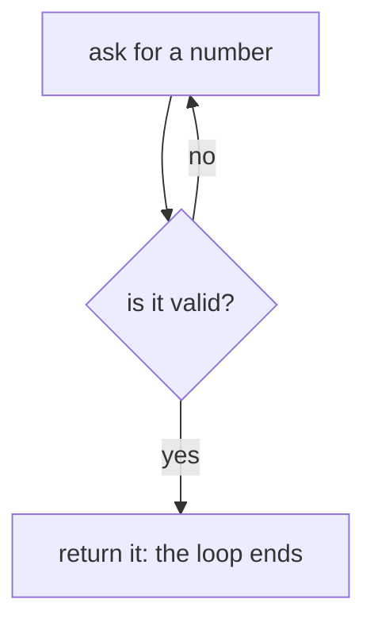

# while and for

A **loop** runs the same lines many times. `while` repeats as long as a condition is true; `for` goes through a sequence, one item at a time.

> **Optional video above.** Harvard's whole lecture for this week (1 h 21 min), by David J. Malan, covering this module. Harvard's own written notes: [CS50P notes, week 2](https://cs50.harvard.edu/python/notes/2/). Everything you need is in the text below, so watch it only if it helps you: inPace remembers where you stopped.

```python
count = 3
while count > 0:
    print(count)
    count -= 1        # forget this line and the loop never ends
print("Go!")

for i in range(3):    # 0, 1, 2
    print("step", i)
```

## Asking until the answer is right

`while True` loops forever, and `break` leaves the loop. Together they're the standard way to validate input. `continue` skips to the next round.



```python
def get_positive():
    while True:
        n = int(input("How many? "))
        if n > 0:
            return n        # return also leaves the loop (and the function)
```

## range in detail

`range(5)` gives 0 to 4. `range(1, 6)` gives 1 to 5. `range(0, 10, 2)` gives 0, 2, 4, 6, 8. The end number is never included.
