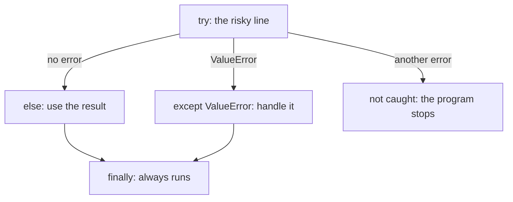

# Errors and try/except

Some errors stop Python from even starting (a `SyntaxError`: a missing quote or colon). Others happen while the program runs, because of the data it gets. Those are **exceptions**, and you can catch them.

> **Optional video above.** Harvard's whole lecture for this week (45 min), by David J. Malan, covering this module. Harvard's own written notes: [CS50P notes, week 3](https://cs50.harvard.edu/python/notes/3/). Everything you need is in the text below, so watch it only if it helps you: inPace remembers where you stopped.

```python
try:
    age = int(input("Age: "))
except ValueError:
    print("Please type a whole number")
else:
    print(f"Next year you'll be {age + 1}")
```



## Read the traceback from the bottom

When a program crashes, Python prints a **traceback**. The last line names the error and says what went wrong; the line above it says where. Common ones:

| Error | Usually means |
|---|---|
| `ValueError` | the right type, but a bad value: `int("cat")` |
| `TypeError` | the wrong type: `"1" + 1` |
| `NameError` | a variable that doesn't exist (often a typo) |
| `KeyError` | a key that isn't in the dict |
| `IndexError` | a list position past the end |
| `ZeroDivisionError` | dividing by zero |

## Catch only what you expect

Write `except ValueError:`, not a bare `except:`. A bare except also hides your own bugs, and even Ctrl+C.
