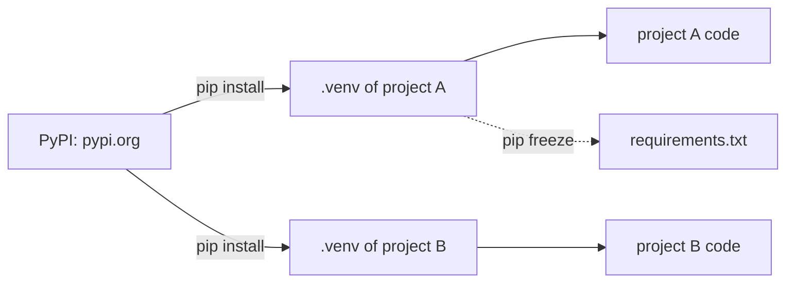

# Packages, pip and virtual environments

Code other people share is on [PyPI](https://pypi.org), and `pip` installs it. Give every project its own **virtual environment** so packages from different projects don't clash:

```bash
python -m venv .venv               # once per project
.venv\Scripts\activate             # Windows
source .venv/bin/activate          # Mac and Linux
pip install requests
pip freeze > requirements.txt      # remember the exact versions
```



## Calling a web API

Many websites answer with **JSON**, text that looks like Python dicts and lists. `requests` downloads it and `.json()` turns it into Python values:

```python
import requests

response = requests.get("https://api.github.com/repos/python/cpython")
data = response.json()
print(data["stargazers_count"], "stars")
```

A package you install isn't in your file, so anyone running your code needs it too: that's what `requirements.txt` is for (`pip install -r requirements.txt`).

Read more: [Virtual environments and packages](https://docs.python.org/3/tutorial/venv.html).
