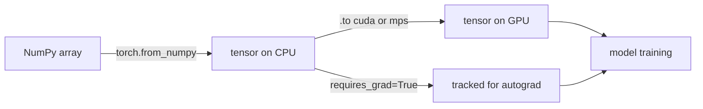

# Tensors: NumPy arrays that run on GPUs and learn

**PyTorch** is the most used deep learning library in research and much of industry. Its core object is the **tensor**: an n-dimensional array like NumPy's, with two superpowers:

1. it can live on a **GPU** (or Apple's MPS), where maths runs much faster;
2. it can record the operations done to it, so PyTorch can compute **gradients** automatically (module 2).



## Install

```bash
pip install torch          # Linux/Windows with an NVIDIA GPU, or Mac; see pytorch.org for the exact command for your system
```

If you have no GPU, everything in this course runs on a CPU (just slower), or use a free GPU notebook such as Google Colab or Kaggle.

## Creating tensors

```python
import numpy as np
import torch

a = torch.tensor([[1.0, 2.0], [3.0, 4.0]])
print(a.shape, a.dtype, a.device)            # torch.Size([2, 2]) torch.float32 cpu

print(torch.zeros(2, 3))
print(torch.ones(2, dtype=torch.int64))
print(torch.arange(0, 10, 3))                # tensor([0, 3, 6, 9])
print(torch.linspace(0, 1, 5))

torch.manual_seed(0)                         # repeatable random numbers
print(torch.randn(2, 2))                     # standard normal
print(torch.rand(3))                         # uniform in [0, 1)
print(torch.randint(0, 10, (4,)))
```

Note one difference from NumPy: `torch.tensor` of Python floats gives **float32** by default, the type deep learning uses.

## Moving between NumPy and PyTorch

```python
x_np = np.arange(4, dtype=np.float32)
x = torch.from_numpy(x_np)       # shares memory with the NumPy array
x_np[0] = 100
print(x)                          # tensor([100., 1., 2., 3.]): changed too
back = x.numpy()                  # also shares memory (CPU tensors only)
safe = torch.tensor(x_np)         # torch.tensor always copies
print(x.tolist(), x.sum().item()) # to Python list / Python number
```

## Devices

```python
device = (
    "cuda" if torch.cuda.is_available()          # NVIDIA GPU
    else "mps" if torch.backends.mps.is_available()   # Apple silicon GPU
    else "cpu"
)
print("using", device)
t = torch.randn(1000, 1000, device=device)       # create directly on the device
u = t.to("cpu")                                  # or move it
print(u.device)
```

Two rules prevent most device bugs: tensors in one operation must be on the **same device**, and moving data between CPU and GPU is slow, so move a whole batch once, not item by item.

## Optional videos

The lesson above is complete on its own. These go deeper, if you like learning by watching.

**PyTorch in 100 Seconds (Fireship)**

https://www.youtube.com/watch?v=ORMx45xqWkA
