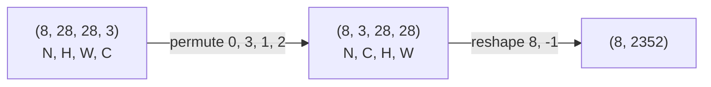

# Tensor operations: maths, shapes and views

Almost every NumPy skill carries over: element-wise maths, reductions with a dimension, broadcasting, indexing, masks. PyTorch calls `axis` **`dim`**.

```python
import torch

torch.manual_seed(0)
x = torch.randn(3, 4)
print(x.sum(), x.mean(dim=0).shape, x.max(dim=1).values.shape)   # dim works like axis
print(x.argmax(dim=1))
print((x > 0).float().mean())               # share of positive values
print(x[x > 1])                             # boolean mask
print(torch.where(x > 0, x, torch.zeros_like(x)).min())   # ReLU by hand: min is 0
w = torch.randn(4, 2)
print((x @ w).shape)                        # matrix multiply: (3, 2)
print((x - x.mean(dim=0, keepdim=True)).mean(dim=0).abs().max() < 1e-6)   # broadcasting; keepdim, not keepdims
```

## Reshaping: view, reshape, permute

```python
images = torch.randn(8, 28, 28, 3)          # batch, height, width, channels (how most image files are laid out)
chw = images.permute(0, 3, 1, 2)            # PyTorch layers expect batch, channels, height, width
print(chw.shape)                            # torch.Size([8, 3, 28, 28])
flat = chw.reshape(8, -1)                   # flatten each image
print(flat.shape)                           # torch.Size([8, 2352])

v = torch.arange(6).view(2, 3)              # view: no copy, needs a compatible memory layout
print(v.is_contiguous(), v.t().is_contiguous())   # True False
print(v.t().reshape(-1))                    # reshape copies when it must; view on v.t() would fail
print(torch.arange(3).unsqueeze(0).shape, torch.zeros(1, 3, 1).squeeze().shape)   # add / remove size-1 dims
print(torch.cat([v, v], dim=0).shape, torch.stack([v, v], dim=0).shape)          # join: (4, 3) vs (2, 2, 3)
```



**`view` vs `reshape`:** `view` never copies and fails if the memory isn't laid out compatibly (for example after `permute` or `.t()`); `reshape` copies when it has to. Use `reshape` unless you need a guarantee of no copy.

**`cat` vs `stack`:** `cat` joins along an existing dimension; `stack` creates a new one. Building a batch from single examples is `stack`.

## In-place operations

Methods ending in `_` change the tensor itself: `x.add_(1)`, `x.zero_()`, `x.clamp_(min=0)`. They save memory but can break gradient tracking (next module), so avoid them on tensors that need gradients unless you know why.

```python
y = torch.ones(3)
y.add_(2)
print(y)                                    # tensor([3., 3., 3.])
```

## Shape habits that save hours

- Write the expected shape as a comment on every line that changes it.
- When something fails, print `.shape`, `.dtype` and `.device` of every input to the line.
- Know your layer's expected layout: images are **(N, C, H, W)**, sequences usually **(N, T, features)** with `batch_first=True`.
