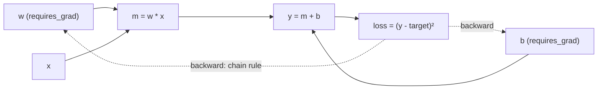

# Autograd: gradients for free

Training a network means finding weights that lower the loss, which needs the **gradient**: how much the loss changes when each weight changes a little. In the NumPy course you derived gradients by hand. **Autograd** does it automatically for any computation.

## How it works

When a tensor has `requires_grad=True`, PyTorch records every operation on it in a **computational graph**. Calling `.backward()` on a scalar result walks the graph backwards, applying the chain rule, and stores each gradient in the input's `.grad`.



```python
import torch

w = torch.tensor(2.0, requires_grad=True)
b = torch.tensor(0.5, requires_grad=True)
x, target = torch.tensor(3.0), torch.tensor(10.0)

y = w * x + b                    # forward: 6.5
loss = (y - target) ** 2         # (6.5 - 10)² = 12.25
loss.backward()                  # compute d loss / d w and d loss / d b
print(loss.item(), w.grad, b.grad)
# d loss/d y = 2(y - target) = -7; d y/d w = x = 3, so d loss/d w = -21; d y/d b = 1, so d loss/d b = -7
```

## The rules you need

```python
w.grad.zero_(); b.grad.zero_()     # 1. gradients ACCUMULATE: reset them before each new backward
for _ in range(2):
    ((w * x + b - target) ** 2).backward()
print(w.grad)                      # -42: two backward calls added up (-21 + -21)

with torch.no_grad():              # 2. no tracking: for updates and for evaluation (faster, less memory)
    w -= 0.01 * w.grad
print(w.requires_grad, (w * 2).requires_grad)

z = (w * 3).detach()               # 3. detach: the same values, cut off from the graph
print(z.requires_grad)
```

Rule 1 surprises everyone once. Accumulation is deliberate (it lets you add up gradients from several small batches), so a training loop always zeroes gradients each step.

## Gradients of whole tensors

```python
torch.manual_seed(0)
W = torch.randn(3, 2, requires_grad=True)
X = torch.randn(5, 3)
out = (X @ W).relu().sum()
out.backward()
print(W.grad.shape)                # same shape as W: one gradient per weight
```

## Check it numerically

You can verify any gradient by nudging a weight and watching the loss, which is a good habit when writing custom layers:

```python
def f(v):
    return (v ** 3).sum()

v = torch.tensor([1.0, 2.0], requires_grad=True)
f(v).backward()
eps = 1e-3
numeric = [(f(v.detach() + eps * torch.eye(2)[i]) - f(v.detach() - eps * torch.eye(2)[i])) / (2 * eps) for i in range(2)]
print(v.grad, torch.stack(numeric))  # both about [3., 12.]: the derivative of v³ is 3v²
```

## Optional videos

The lesson above is complete on its own. These go deeper, if you like learning by watching.

**The spelled-out intro to neural networks and backpropagation: building micrograd (Andrej Karpathy)**

https://www.youtube.com/watch?v=VMj-3S1tku0

**Backpropagation, intuitively (3Blue1Brown, chapter 3)**

https://www.youtube.com/watch?v=Ilg3gGewQ5U
