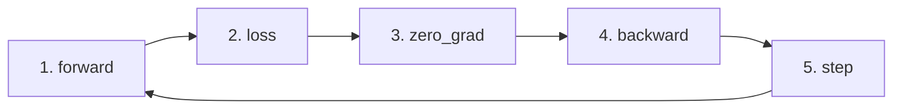

# Gradient descent with autograd and optimizers

Here is the NumPy linear regression again, now with PyTorch computing the gradients. Then we replace the manual update with an **optimizer**.

```python
import torch

torch.manual_seed(0)
X = torch.randn(200, 3)
true_w, true_b = torch.tensor([2.0, -1.0, 0.5]), 3.0
y = X @ true_w + true_b + 0.1 * torch.randn(200)

w = torch.zeros(3, requires_grad=True)
b = torch.zeros(1, requires_grad=True)
lr = 0.1
for step in range(200):
    pred = X @ w + b
    loss = ((pred - y) ** 2).mean()
    loss.backward()                       # gradients appear in w.grad and b.grad
    with torch.no_grad():
        w -= lr * w.grad
        b -= lr * b.grad
    w.grad.zero_(); b.grad.zero_()
print(w.detach().round(decimals=2), b.item())
```

No hand-written gradients, and it works the same for a model with a million weights.

## Optimizers

`torch.optim` packages update rules. The loop always has the same five lines:

```python
w = torch.zeros(3, requires_grad=True)
b = torch.zeros(1, requires_grad=True)
opt = torch.optim.SGD([w, b], lr=0.1)

for step in range(200):
    pred = X @ w + b              # 1. forward
    loss = ((pred - y) ** 2).mean()   # 2. loss
    opt.zero_grad()               # 3. clear old gradients
    loss.backward()               # 4. compute new ones
    opt.step()                    # 5. update the weights
print(w.detach().round(decimals=2), round(loss.item(), 4))
```



## Which optimizer?

| Optimizer | Idea | Use |
|---|---|---|
| `SGD` | step against the gradient | simple; with `momentum=0.9`, still strong for CNNs |
| `Adam` | per-weight step sizes from running averages of gradients | fast, forgiving default |
| `AdamW` | Adam with weight decay applied correctly | the usual default for transformers and most new projects |

## The learning rate is the most important setting

Too high and the loss jumps around or explodes into `nan`; too low and training crawls. Try values a factor of 10 apart (1e-1, 1e-2, 1e-3) and watch the loss for the first few hundred steps:

```python
for lr in [1.0, 0.1, 0.001]:
    w = torch.zeros(3, requires_grad=True); b = torch.zeros(1, requires_grad=True)
    opt = torch.optim.SGD([w, b], lr=lr)
    for step in range(50):
        loss = ((X @ w + b - y) ** 2).mean()
        opt.zero_grad(); loss.backward(); opt.step()
    print(f"lr={lr}: loss after 50 steps {loss.item():.4f}")
```

Typical starting points: about 1e-3 for Adam/AdamW, 1e-2 to 1e-1 for SGD with momentum. Part 2 adds learning-rate schedules.

## Optional videos

The lesson above is complete on its own. These go deeper, if you like learning by watching.

**Gradient descent, how neural networks learn (3Blue1Brown, chapter 2)**

https://www.youtube.com/watch?v=IHZwWFHWa-w
