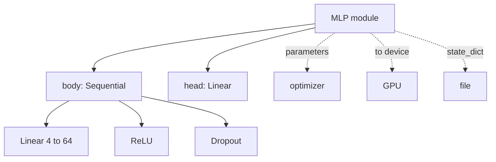

# nn.Module: building models from layers

Writing `X @ w + b` by hand doesn't scale. `torch.nn` provides **layers** (which own their weights) and **`nn.Module`**, the base class for every model: it collects all parameters, moves them between devices, switches train/eval behaviour, and saves and loads them.

## Layers

```python
import torch
from torch import nn

torch.manual_seed(0)
layer = nn.Linear(in_features=4, out_features=3)     # weight (3, 4) and bias (3,), already initialised
x = torch.randn(10, 4)
print(layer(x).shape)                                # torch.Size([10, 3])
print(layer.weight.shape, layer.bias.shape, layer.weight.requires_grad)
```

Common building blocks: `nn.Linear`, `nn.Conv2d`, `nn.Embedding`, `nn.LSTM`, `nn.LayerNorm`, `nn.BatchNorm1d`, `nn.Dropout`, activations such as `nn.ReLU` and `nn.GELU`.

## Sequential for simple stacks

```python
mlp = nn.Sequential(
    nn.Linear(4, 32),
    nn.ReLU(),
    nn.Linear(32, 32),
    nn.ReLU(),
    nn.Linear(32, 3),          # 3 class scores (logits)
)
print(mlp(x).shape)
print(sum(p.numel() for p in mlp.parameters()), "parameters")   # 4·32+32 + 32·32+32 + 32·3+3 = 1,315
```

## Your own Module for anything else

```python
class MLP(nn.Module):
    def __init__(self, n_in, n_hidden, n_out, p_drop=0.1):
        super().__init__()                        # always first
        self.body = nn.Sequential(nn.Linear(n_in, n_hidden), nn.ReLU(), nn.Dropout(p_drop))
        self.head = nn.Linear(n_hidden, n_out)

    def forward(self, x):                         # define the forward pass; backward is automatic
        h = self.body(x)
        return self.head(h)

model = MLP(4, 64, 3)
print(model)
for name, p in model.named_parameters():
    print(name, tuple(p.shape))
```

Layers assigned as attributes in `__init__` are registered automatically, so `model.parameters()` finds them. Put layers in `nn.ModuleList` or `nn.ModuleDict` when you have a variable number of them, never in a plain Python list (they would be invisible to the optimizer).



## train() and eval()

Some layers behave differently while training: **Dropout** randomly zeroes activations only in training, and **BatchNorm** uses batch statistics in training and stored averages in evaluation.

```python
model.train()
a, b = model(x), model(x)
print(torch.equal(a, b))        # False: dropout is random
model.eval()
with torch.no_grad():
    print(torch.equal(model(x), model(x)))   # True
```

Forgetting `model.eval()` before evaluating is one of the most common PyTorch bugs: the scores come out noisy and too low.

## Optional videos

The lesson above is complete on its own. These go deeper, if you like learning by watching.

**But what is a neural network? (3Blue1Brown, chapter 1)**

https://www.youtube.com/watch?v=aircAruvnKk
