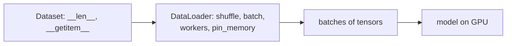

# Dataset and DataLoader

Slicing tensors by hand works for small data in memory. Real projects read images from disk, apply random augmentation, and feed batches to a GPU without making it wait. PyTorch splits that work in two:

- a **Dataset** knows how many examples there are and how to get example `i`;
- a **DataLoader** shuffles, groups examples into batches, and can load in parallel worker processes.



## A Dataset

```python
import numpy as np
import torch
from torch.utils.data import Dataset, DataLoader, random_split
from sklearn.datasets import load_digits          # 1,797 handwritten digits of 8×8 pixels, bundled offline

class Digits(Dataset):
    def __init__(self, transform=None):
        d = load_digits()
        self.x = torch.tensor(d.images, dtype=torch.float32).unsqueeze(1) / 16.0   # (N, 1, 8, 8), scaled to 0..1
        self.y = torch.tensor(d.target, dtype=torch.long)
        self.transform = transform

    def __len__(self):
        return len(self.y)

    def __getitem__(self, i):
        x = self.x[i]
        if self.transform:
            x = self.transform(x)
        return x, self.y[i]

ds = Digits()
print(len(ds), ds[0][0].shape, ds[0][1])           # 1797 torch.Size([1, 8, 8]) tensor(0)
```

For data already in tensors, `torch.utils.data.TensorDataset(X, y)` does the same in one line; for image folders, `torchvision.datasets.ImageFolder` reads one sub-folder per class.

## Splitting and loading

```python
g = torch.Generator().manual_seed(0)
train_ds, val_ds = random_split(ds, [0.8, 0.2], generator=g)
train_dl = DataLoader(train_ds, batch_size=64, shuffle=True)
val_dl = DataLoader(val_ds, batch_size=256)
xb, yb = next(iter(train_dl))
print(xb.shape, yb.shape, len(train_dl))           # torch.Size([64, 1, 8, 8]) torch.Size([64]) 23
```

## Transforms: augmentation on the fly

A transform is a function applied to each example when it's loaded, so every epoch sees slightly different versions:

```python
def add_noise(x):
    return (x + 0.05 * torch.randn_like(x)).clamp(0, 1)

noisy = Digits(transform=add_noise)
print(torch.equal(noisy[0][0], noisy[0][0]))       # False: a new random version each time
```

`torchvision.transforms.v2` provides ready-made image transforms (random crops, flips, colour jitter, normalisation) that you chain with `v2.Compose`. Only augment the training set; validation data must stay fixed.

## DataLoader settings that matter

| Setting | Why |
|---|---|
| `shuffle=True` for training only | random batch order; the same order for validation keeps results comparable |
| `num_workers=4` (or so) | load and augment in parallel processes, so the GPU isn't waiting |
| `pin_memory=True` with a CUDA GPU | faster copies from CPU to GPU |
| `drop_last=True` | avoids a tiny last batch, which can upset batch norm |
| `collate_fn` | custom batching, for example padding sequences of different lengths |
