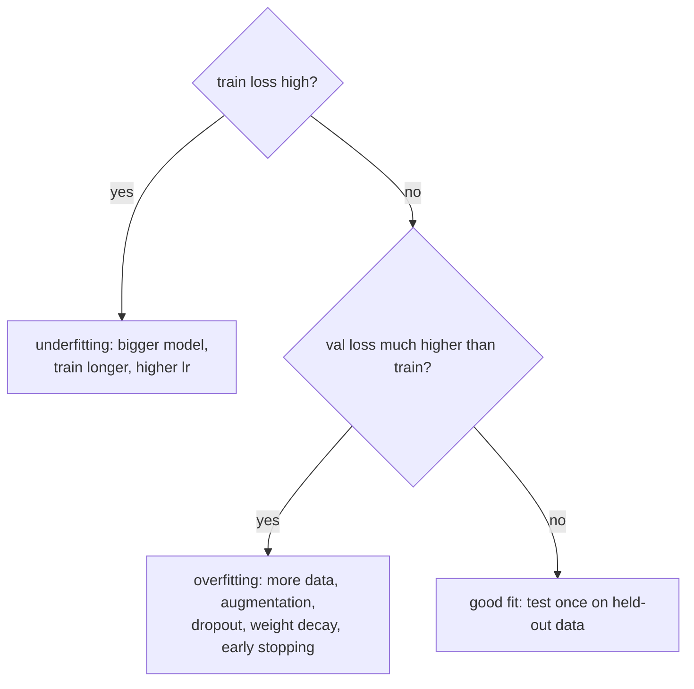

# Training and validation loops that scale

Now combine module 3's loop with DataLoaders, a device, metrics per epoch, the best checkpoint, and early stopping. This is the template you'll reuse for most of the series.

```python
import copy
import torch
from torch import nn
from torch.utils.data import DataLoader, TensorDataset, random_split
from sklearn.datasets import load_digits

torch.manual_seed(0)
d = load_digits()
X = torch.tensor(d.data, dtype=torch.float32) / 16.0          # (1797, 64): flattened 8×8 images
y = torch.tensor(d.target)
train_ds, val_ds = random_split(TensorDataset(X, y), [0.8, 0.2], generator=torch.Generator().manual_seed(0))
train_dl = DataLoader(train_ds, batch_size=64, shuffle=True)
val_dl = DataLoader(val_ds, batch_size=512)

device = "cuda" if torch.cuda.is_available() else "cpu"
model = nn.Sequential(nn.Linear(64, 128), nn.ReLU(), nn.Dropout(0.2), nn.Linear(128, 10)).to(device)
opt = torch.optim.AdamW(model.parameters(), lr=1e-3, weight_decay=1e-2)
loss_fn = nn.CrossEntropyLoss()

def run_epoch(dl, train):
    model.train(train)
    total_loss, correct, n = 0.0, 0, 0
    with torch.set_grad_enabled(train):
        for xb, yb in dl:
            xb, yb = xb.to(device), yb.to(device)          # move each batch once
            logits = model(xb)
            loss = loss_fn(logits, yb)
            if train:
                opt.zero_grad()
                loss.backward()
                opt.step()
            total_loss += loss.item() * len(yb)
            correct += (logits.argmax(1) == yb).sum().item()
            n += len(yb)
    return total_loss / n, correct / n

best_acc, best_state, patience, bad_epochs = 0.0, None, 5, 0
for epoch in range(100):
    tr_loss, tr_acc = run_epoch(train_dl, train=True)
    va_loss, va_acc = run_epoch(val_dl, train=False)
    if va_acc > best_acc:
        best_acc, best_state, bad_epochs = va_acc, copy.deepcopy(model.state_dict()), 0
    else:
        bad_epochs += 1
    if epoch % 5 == 0:
        print(f"epoch {epoch:3d}  train {tr_loss:.3f}/{tr_acc:.3f}  val {va_loss:.3f}/{va_acc:.3f}")
    if bad_epochs >= patience:
        print(f"early stop at epoch {epoch}, best val accuracy {best_acc:.3f}")
        break
model.load_state_dict(best_state)
```

## Reading the curves



## Saving and loading

Save the **state_dict** (a dictionary of tensors), not the whole model object:

```python
torch.save(model.state_dict(), "digits_mlp.pt")

fresh = nn.Sequential(nn.Linear(64, 128), nn.ReLU(), nn.Dropout(0.2), nn.Linear(128, 10))
fresh.load_state_dict(torch.load("digits_mlp.pt", weights_only=True))
fresh.eval()
print(fresh(X[:1]).argmax().item(), y[0].item())
```

`weights_only=True` (the default in recent PyTorch) loads only tensors, so a file from a stranger can't run code on your machine. To resume training later, also save the optimizer's `state_dict()` and the epoch number in the same file.
