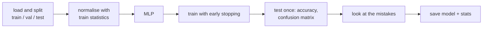

# Project: a digit classifier from start to finish

Put the whole course together on the offline digits dataset: data, model, training, evaluation, error analysis and a saved model that predicts new inputs.



```python
import torch
from torch import nn
from torch.utils.data import DataLoader, TensorDataset
from sklearn.datasets import load_digits
from sklearn.model_selection import train_test_split

torch.manual_seed(0)
d = load_digits()
X_tmp, X_test, y_tmp, y_test = train_test_split(d.data, d.target, test_size=0.2, random_state=0, stratify=d.target)
X_train, X_val, y_train, y_val = train_test_split(X_tmp, y_tmp, test_size=0.2, random_state=0, stratify=y_tmp)

to_t = lambda a, dt=torch.float32: torch.tensor(a, dtype=dt)
mean, std = to_t(X_train).mean(0), to_t(X_train).std(0) + 1e-6      # statistics from TRAIN only
norm = lambda a: (to_t(a) - mean) / std
Xtr, Xva, Xte = norm(X_train), norm(X_val), norm(X_test)
ytr, yva, yte = (to_t(a, torch.long) for a in (y_train, y_val, y_test))

model = nn.Sequential(nn.Linear(64, 128), nn.ReLU(), nn.Dropout(0.2), nn.Linear(128, 64), nn.ReLU(), nn.Linear(64, 10))
opt = torch.optim.AdamW(model.parameters(), lr=1e-3, weight_decay=1e-2)
loss_fn = nn.CrossEntropyLoss()
dl = DataLoader(TensorDataset(Xtr, ytr), batch_size=64, shuffle=True)

best, best_state = 0.0, None
for epoch in range(60):
    model.train()
    for xb, yb in dl:
        loss = loss_fn(model(xb), yb)
        opt.zero_grad(); loss.backward(); opt.step()
    model.eval()
    with torch.no_grad():
        acc = (model(Xva).argmax(1) == yva).float().mean().item()
    if acc > best:
        best, best_state = acc, {k: v.clone() for k, v in model.state_dict().items()}
model.load_state_dict(best_state)
print(f"best validation accuracy {best:.3f}")
```

## Test once, then look at the errors

```python
model.eval()
with torch.no_grad():
    pred = model(Xte).argmax(1)
print(f"test accuracy {(pred == yte).float().mean().item():.3f}")

cm = torch.zeros(10, 10, dtype=torch.long)
for t, p in zip(yte, pred):
    cm[t, p] += 1
print(cm)                                          # rows: true digit, columns: predicted
wrong = (pred != yte).nonzero().flatten()
print("misclassified examples:", [(yte[i].item(), pred[i].item()) for i in wrong[:5]])
```

The confusion matrix shows *which* digits get confused (here, an 8 read as a 1, and 4s read as other digits). That's where you'd focus: more data of those digits, augmentation, or a model that sees the 2-D layout (the CNN in part 2).

## Save everything prediction needs

```python
torch.save({"state_dict": model.state_dict(), "mean": mean, "std": std}, "digits_model.pt")

ckpt = torch.load("digits_model.pt", weights_only=True)
model.load_state_dict(ckpt["state_dict"])
new_image = torch.tensor(d.data[0], dtype=torch.float32)
x = ((new_image - ckpt["mean"]) / ckpt["std"]).unsqueeze(0)     # same preprocessing as training
print("predicted digit:", model(x).argmax(1).item(), "| true:", d.target[0])
```

A model is only usable with its preprocessing. Saving the normalisation statistics with the weights avoids the classic bug where production inputs are scaled differently from training inputs.

## Optional videos

The lesson above is complete on its own. These go deeper, if you like learning by watching.

**PyTorch for Deep Learning and Machine Learning, full course (freeCodeCamp.org, Daniel Bourke)**

https://www.youtube.com/watch?v=V_xro1bcAuA
