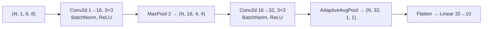

# Convolutional networks in PyTorch

Part 1 flattened each digit into 64 numbers, throwing away which pixels are neighbours. A **CNN** keeps the 2-D layout: small learned filters slide over the image, so a stroke is recognised wherever it appears.



## The layers

| Layer | What it does | Shape effect |
|---|---|---|
| `nn.Conv2d(in_ch, out_ch, kernel_size, padding=1)` | out_ch learned filters over all in_ch channels | (N, in, H, W) to (N, out, H, W) with padding 1 for 3×3 |
| `nn.BatchNorm2d(ch)` | normalises each channel over the batch, then rescales | same shape; faster, more stable training |
| `nn.MaxPool2d(2)` | keeps the max of each 2×2 block | halves H and W |
| `nn.AdaptiveAvgPool2d(1)` | averages each channel to one number | (N, C, H, W) to (N, C, 1, 1) for any H, W |
| `nn.Flatten()` | joins all but the batch dimension | (N, C, 1, 1) to (N, C) |

## Training a CNN against the MLP

```python
import torch
from torch import nn
from torch.utils.data import DataLoader, TensorDataset
from sklearn.datasets import load_digits
from sklearn.model_selection import train_test_split

torch.manual_seed(0)
d = load_digits()
X = torch.tensor(d.images, dtype=torch.float32).unsqueeze(1) / 16.0     # (1797, 1, 8, 8)
y = torch.tensor(d.target)
Xtr, Xva, ytr, yva = train_test_split(X, y, test_size=0.25, random_state=0, stratify=y)
train_dl = DataLoader(TensorDataset(Xtr, ytr), batch_size=64, shuffle=True)

def fit(model, epochs=15, lr=1e-3):
    opt = torch.optim.AdamW(model.parameters(), lr=lr)
    for _ in range(epochs):
        model.train()
        for xb, yb in train_dl:
            loss = nn.functional.cross_entropy(model(xb), yb)
            opt.zero_grad(); loss.backward(); opt.step()
    model.eval()
    with torch.no_grad():
        return (model(Xva).argmax(1) == yva).float().mean().item()

mlp = nn.Sequential(nn.Flatten(), nn.Linear(64, 128), nn.ReLU(), nn.Linear(128, 10))
cnn = nn.Sequential(
    nn.Conv2d(1, 16, 3, padding=1), nn.BatchNorm2d(16), nn.ReLU(),
    nn.MaxPool2d(2),
    nn.Conv2d(16, 32, 3, padding=1), nn.BatchNorm2d(32), nn.ReLU(),
    nn.AdaptiveAvgPool2d(1), nn.Flatten(),
    nn.Linear(32, 10),
)
count = lambda m: sum(p.numel() for p in m.parameters())
print(f"MLP: {count(mlp):,} parameters, val accuracy {fit(mlp):.3f}")
print(f"CNN: {count(cnn):,} parameters, val accuracy {fit(cnn):.3f}")
```

The CNN reaches better accuracy with about half the parameters, because the same small filters are reused at every position. On bigger images (photos of 224×224 pixels and more) the gap becomes huge: an MLP on raw pixels doesn't scale at all.

## Checking shapes as you design

Pass a dummy batch through the layers one by one and print shapes; it's the fastest way to design a network.

```python
x = torch.zeros(2, 1, 8, 8)
for layer in cnn:
    x = layer(x)
    print(f"{layer.__class__.__name__:18s} {tuple(x.shape)}")
```

`nn.LazyLinear(10)` is another option: it infers its input size the first time it sees data.

## BatchNorm and Dropout in CNNs

BatchNorm after each convolution lets you use higher learning rates and makes training less sensitive to initialisation; it's standard in CNNs. Because it uses batch statistics in training and running averages in evaluation, `model.train()` / `model.eval()` matter even more here. Use `nn.Dropout` mostly before the final linear layer; in conv blocks, data augmentation usually helps more.

## Optional videos

The lesson above is complete on its own. These go deeper, if you like learning by watching.

**But what is a convolution? (3Blue1Brown)**

https://www.youtube.com/watch?v=KuXjwB4LzSA

**CNN: Convolutional Neural Networks Explained (Computerphile)**

https://www.youtube.com/watch?v=py5byOOHZM8

**CS231n Lecture 5: convolutional neural networks (Stanford)**

https://www.youtube.com/watch?v=bNb2fEVKeEo
