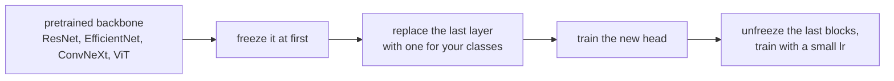

# Transfer learning with torchvision

Training a big CNN from scratch needs millions of labelled images. **Transfer learning** starts from a network already trained on a large dataset (usually ImageNet) and adapts it to your classes with a few hundred or thousand images. It's the default for real image projects.



## Load a model and swap the head

```python
import torch
from torch import nn
from torchvision import models

# With internet, load ImageNet weights (downloaded once, then cached):
#   weights = models.ResNet18_Weights.DEFAULT
#   model = models.resnet18(weights=weights)
#   preprocess = weights.transforms()        # the exact resizing and normalisation the weights expect
model = models.resnet18(weights=None)         # same architecture, random weights (works offline)
print(model.fc)                               # Linear(in_features=512, out_features=1000): ImageNet's 1000 classes

num_classes = 3
for p in model.parameters():
    p.requires_grad = False                   # freeze the backbone
model.fc = nn.Linear(model.fc.in_features, num_classes)   # new head, trainable by default

trainable = [n for n, p in model.named_parameters() if p.requires_grad]
print(trainable)                              # ['fc.weight', 'fc.bias']
x = torch.randn(4, 3, 224, 224)
print(model(x).shape)                         # torch.Size([4, 3])
opt = torch.optim.AdamW([p for p in model.parameters() if p.requires_grad], lr=1e-3)
```

Then, once the head has learned, unfreeze the last block and fine-tune everything trainable with a lower learning rate, often 10 times smaller for the backbone:

```python
for p in model.layer4.parameters():
    p.requires_grad = True
opt = torch.optim.AdamW([
    {"params": model.layer4.parameters(), "lr": 1e-4},
    {"params": model.fc.parameters(), "lr": 1e-3},
])
print([g["lr"] for g in opt.param_groups])
```

## Images and augmentation with transforms v2

```python
from torchvision.transforms import v2

train_tf = v2.Compose([
    v2.RandomResizedCrop(224, scale=(0.7, 1.0)),
    v2.RandomHorizontalFlip(),
    v2.ColorJitter(brightness=0.2, contrast=0.2),
    v2.ToDtype(torch.float32, scale=True),                      # uint8 0..255 to float 0..1
    v2.Normalize(mean=[0.485, 0.456, 0.406], std=[0.229, 0.224, 0.225]),   # ImageNet statistics
])
val_tf = v2.Compose([v2.Resize(256), v2.CenterCrop(224), v2.ToDtype(torch.float32, scale=True),
                     v2.Normalize(mean=[0.485, 0.456, 0.406], std=[0.229, 0.224, 0.225])])
img = torch.randint(0, 256, (3, 300, 400), dtype=torch.uint8)     # stands in for a photo read with torchvision.io.decode_image
print(train_tf(img).shape, val_tf(img).shape)
```

With your photos in `data/train/<class>/...` and `data/val/<class>/...`, `torchvision.datasets.ImageFolder("data/train", transform=train_tf)` gives a ready Dataset.

**Use the normalisation the weights were trained with**; `weights.transforms()` returns it. The v2 transforms also transform bounding boxes and masks together with the image, which matters for detection and segmentation.

## Choosing a backbone

| Need | Try first |
|---|---|
| fast, phones or small GPUs | MobileNetV3, EfficientNet-B0 |
| solid general default | ResNet-50, ConvNeXt-Tiny |
| best accuracy with more compute | ViT or ConvNeXt variants, or a model from the `timm` library |
