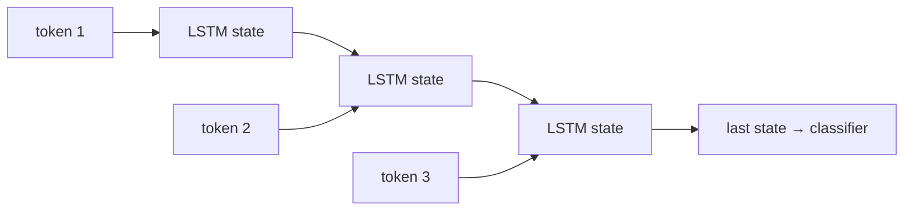

# Embeddings, sequences and RNNs

Text, audio and time series are **sequences**. Two building blocks get them into a network.

## Embeddings: ids to vectors

An `nn.Embedding(num_tokens, dim)` is a learnable table: token id `i` maps to row `i`. It's how every language model starts.

```python
import torch
from torch import nn

torch.manual_seed(0)
emb = nn.Embedding(num_embeddings=100, embedding_dim=8, padding_idx=0)   # id 0 = padding, stays zero
ids = torch.tensor([[5, 23, 7, 0], [42, 9, 0, 0]])                      # (batch 2, length 4), padded with 0
vec = emb(ids)
print(vec.shape)                                                        # torch.Size([2, 4, 8])
print(vec[0, 3].abs().sum().item())                                     # 0.0: the padding vector
```

## Padding a batch with collate_fn

Sentences have different lengths, but a batch must be a rectangle. A **collate function** pads each batch to its longest item:

```python
from torch.nn.utils.rnn import pad_sequence
from torch.utils.data import DataLoader

data = [(torch.tensor([3, 4, 5]), 1), (torch.tensor([6, 7]), 0), (torch.tensor([8, 9, 10, 11]), 1)]

def collate(batch):
    seqs, labels = zip(*batch)
    lengths = torch.tensor([len(s) for s in seqs])
    return pad_sequence(seqs, batch_first=True, padding_value=0), lengths, torch.tensor(labels)

xb, lengths, yb = next(iter(DataLoader(data, batch_size=3, collate_fn=collate)))
print(xb, lengths)
```

## RNNs and LSTMs

A recurrent network reads a sequence step by step, updating a hidden state. An **LSTM** adds gates that decide what to keep and forget, so information survives over longer sequences.



```python
class TextClassifier(nn.Module):
    def __init__(self, vocab, dim=32, hidden=64, classes=2):
        super().__init__()
        self.emb = nn.Embedding(vocab, dim, padding_idx=0)
        self.lstm = nn.LSTM(dim, hidden, batch_first=True)
        self.head = nn.Linear(hidden, classes)

    def forward(self, ids, lengths):
        packed = nn.utils.rnn.pack_padded_sequence(self.emb(ids), lengths, batch_first=True, enforce_sorted=False)
        _, (h, _) = self.lstm(packed)             # h: (layers, batch, hidden); padding is skipped
        return self.head(h[-1])

# toy task: does the sequence contain token 7?
torch.manual_seed(0)
seqs = [torch.randint(1, 20, (int(torch.randint(3, 12, ()).item()),)) for _ in range(800)]
data = [(s, int((s == 7).any())) for s in seqs]
dl = DataLoader(data[:600], batch_size=32, shuffle=True, collate_fn=collate)
model = TextClassifier(vocab=20)
opt = torch.optim.Adam(model.parameters(), lr=1e-2)
for epoch in range(8):
    for xb, lb, yb in dl:
        loss = nn.functional.cross_entropy(model(xb, lb), yb)
        opt.zero_grad(); loss.backward(); opt.step()
xv, lv, yv = collate(data[600:])
with torch.no_grad():
    print("val accuracy:", (model(xv, lv).argmax(1) == yv).float().mean().item())
```

`pack_padded_sequence` tells the LSTM where each sequence really ends, so padding doesn't pollute the final state.

## Where RNNs stand today

RNNs read one step at a time, so training can't run in parallel over a sequence, and very long dependencies are still hard. **Transformers** (next lesson) replaced them for most language tasks. LSTMs and GRUs remain useful for small, streaming or on-device problems such as sensor data, and newer **state-space models** (like Mamba) revive the recurrent idea at scale.
