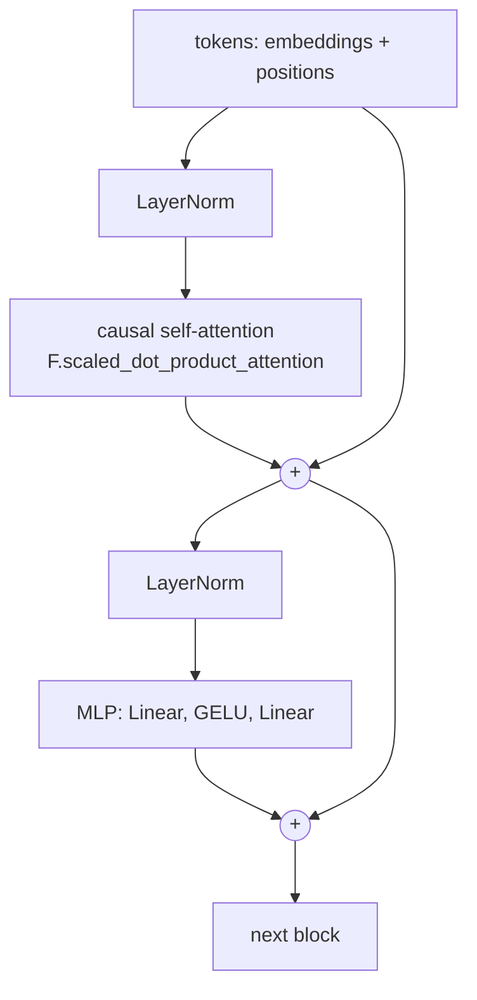

# Transformers in PyTorch

A transformer block lets every token look at the others with **attention**, then processes each token with a small MLP. PyTorch gives you the fast pieces; you assemble them.



## Attention with one function

`F.scaled_dot_product_attention(q, k, v, is_causal=True)` computes softmax(QKᵀ/√d)·V with a causal mask, choosing an efficient kernel (such as FlashAttention on supported GPUs) automatically.

```python
import math
import torch
from torch import nn
import torch.nn.functional as F

class CausalSelfAttention(nn.Module):
    def __init__(self, dim, heads):
        super().__init__()
        assert dim % heads == 0
        self.heads = heads
        self.qkv = nn.Linear(dim, 3 * dim)
        self.proj = nn.Linear(dim, dim)

    def forward(self, x):                                  # x: (B, T, C)
        B, T, C = x.shape
        q, k, v = self.qkv(x).split(C, dim=2)
        q, k, v = (t.view(B, T, self.heads, C // self.heads).transpose(1, 2) for t in (q, k, v))   # (B, h, T, d)
        y = F.scaled_dot_product_attention(q, k, v, is_causal=True)
        return self.proj(y.transpose(1, 2).reshape(B, T, C))

class Block(nn.Module):
    def __init__(self, dim, heads):
        super().__init__()
        self.ln1, self.ln2 = nn.LayerNorm(dim), nn.LayerNorm(dim)
        self.attn = CausalSelfAttention(dim, heads)
        self.mlp = nn.Sequential(nn.Linear(dim, 4 * dim), nn.GELU(), nn.Linear(4 * dim, dim))

    def forward(self, x):
        x = x + self.attn(self.ln1(x))                     # residual connections around each part
        return x + self.mlp(self.ln2(x))

# check against the formula written out by hand
torch.manual_seed(0)
q, k, v = torch.randn(3, 1, 2, 5, 4).unbind(0)
mask = torch.triu(torch.ones(5, 5, dtype=torch.bool), 1)
manual = (q @ k.transpose(-2, -1) / math.sqrt(4)).masked_fill(mask, float("-inf")).softmax(-1) @ v
print(torch.allclose(manual, F.scaled_dot_product_attention(q, k, v, is_causal=True), atol=1e-6))
```

## A tiny GPT

```python
class TinyGPT(nn.Module):
    def __init__(self, vocab, dim=64, heads=4, layers=2, ctx=32):
        super().__init__()
        self.tok = nn.Embedding(vocab, dim)
        self.pos = nn.Embedding(ctx, dim)
        self.blocks = nn.Sequential(*[Block(dim, heads) for _ in range(layers)])
        self.ln = nn.LayerNorm(dim)
        self.head = nn.Linear(dim, vocab, bias=False)
        self.head.weight = self.tok.weight                  # weight tying: input and output embeddings shared

    def forward(self, idx):                                # idx: (B, T) token ids
        T = idx.shape[1]
        x = self.tok(idx) + self.pos(torch.arange(T, device=idx.device))
        return self.head(self.ln(self.blocks(x)))           # (B, T, vocab) logits

text = "to be or not to be that is the question " * 50
chars = sorted(set(text)); stoi = {c: i for i, c in enumerate(chars)}
data = torch.tensor([stoi[c] for c in text])
torch.manual_seed(0)
model = TinyGPT(len(chars))
opt = torch.optim.AdamW(model.parameters(), lr=3e-3)
for step in range(300):
    ix = torch.randint(0, len(data) - 33, (16,))
    xb = torch.stack([data[i:i + 32] for i in ix]); yb = torch.stack([data[i + 1:i + 33] for i in ix])
    loss = F.cross_entropy(model(xb).reshape(-1, len(chars)), yb.reshape(-1))
    opt.zero_grad(); loss.backward(); opt.step()
print(f"loss {loss.item():.3f}")

idx = torch.tensor([[stoi["t"]]])
with torch.no_grad():
    for _ in range(40):
        probs = model(idx[:, -32:])[:, -1].softmax(-1)
        idx = torch.cat([idx, torch.multinomial(probs, 1)], dim=1)
print("".join(chars[i] for i in idx[0].tolist()))
```

The model learns the repeated phrase almost perfectly; the Karpathy course in this library builds the same model step by step on real text.

## Built-in modules

`nn.MultiheadAttention`, `nn.TransformerEncoderLayer` and `nn.TransformerEncoder` exist and are fine for standard encoders. Most modern code writes the block by hand (as above) around `scaled_dot_product_attention`, because variants (rotary positions, grouped-query attention, different norms) are easier to change. For pretrained transformers, use Hugging Face (later in this series).

## Optional videos

The lesson above is complete on its own. These go deeper, if you like learning by watching.

**Attention in transformers, step by step (3Blue1Brown, chapter 6)**

https://www.youtube.com/watch?v=eMlx5fFNoYc

**Transformers, the tech behind LLMs (3Blue1Brown, Deep Learning chapter 5)**

https://www.youtube.com/watch?v=wjZofJX0v4M

**Let's build GPT: from scratch, in code, spelled out (Andrej Karpathy)**

https://www.youtube.com/watch?v=kCc8FmEb1nY
