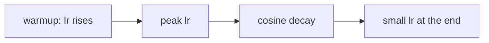

# Training craft: schedules, regularisation and clipping

The same model can be mediocre or excellent depending on how it's trained. These are the settings that matter most, in roughly the order to try them.

## Learning-rate schedules

A fixed learning rate is rarely best: high early (fast progress), low late (fine settling). Two schedules cover most needs:

- **Warmup + cosine decay:** ramp up for the first few percent of steps, then follow a cosine curve down. The default for transformers.
- **One-cycle:** up then down within one run; strong for CNNs.

```python
import math
import torch
from torch import nn

model = nn.Linear(10, 2)
opt = torch.optim.AdamW(model.parameters(), lr=1e-3, weight_decay=0.05)
total, warmup = 1000, 50

def lr_lambda(step):
    if step < warmup:
        return (step + 1) / warmup                               # linear warmup
    progress = (step - warmup) / (total - warmup)
    return 0.5 * (1 + math.cos(math.pi * progress))               # cosine down to 0

sched = torch.optim.lr_scheduler.LambdaLR(opt, lr_lambda)
lrs = []
for step in range(total):
    opt.step()                                                    # (after backward, in a real loop)
    sched.step()                                                  # once per step, after opt.step()
    lrs.append(opt.param_groups[0]["lr"])
print([f"{lrs[i]:.2e}" for i in (0, 49, 500, 999)])
```

Ready-made schedulers include `OneCycleLR`, `CosineAnnealingLR`, `LinearLR` and `SequentialLR` (to chain warmup and cosine). Call `sched.step()` where its documentation says: per step for most modern schedules, per epoch for some older ones.



## Regularisation

| Tool | How | Typical value |
|---|---|---|
| Weight decay | `AdamW(weight_decay=...)` pulls weights toward zero | 0.01 to 0.1 |
| Dropout | `nn.Dropout(p)` | 0.1 to 0.3 |
| Data augmentation | random transforms of inputs | as strong as the task allows |
| Label smoothing | `nn.CrossEntropyLoss(label_smoothing=0.1)`: targets of 0.9 instead of 1 | 0.05 to 0.1 |
| Early stopping | keep the best validation checkpoint | patience of a few epochs |

Don't apply weight decay to biases and normalisation weights; a common pattern puts parameters into two groups:

```python
decay = [p for n, p in model.named_parameters() if p.dim() >= 2]
no_decay = [p for n, p in model.named_parameters() if p.dim() < 2]
opt = torch.optim.AdamW([{"params": decay, "weight_decay": 0.05}, {"params": no_decay, "weight_decay": 0.0}], lr=1e-3)
print(len(decay), len(no_decay))
```

## Gradient clipping

A single bad batch can produce a huge gradient and wreck training (common with RNNs and transformers). Clipping caps the overall gradient size:

```python
x, y = torch.randn(8, 10) * 100, torch.randint(0, 2, (8,))
loss = nn.functional.cross_entropy(model(x), y)
opt.zero_grad(); loss.backward()
norm = torch.nn.utils.clip_grad_norm_(model.parameters(), max_norm=1.0)   # returns the norm before clipping
print(f"gradient norm before clipping: {norm.item():.1f}")
opt.step()
```

Clip after `backward()` and before `step()`. Logging the returned norm is a cheap early warning: spikes come before loss explosions.

## Initialisation

PyTorch layers come with sensible default initialisation. Change it only with a reason, using `nn.init` (for example `nn.init.zeros_` on the last layer of a residual branch, or small normal initialisation in GPT-style models), and always check the loss at step 0 (about ln(classes) for classification).
