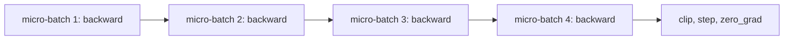

# Mixed precision, gradient accumulation and resuming

## Mixed precision

GPUs compute much faster in 16-bit formats. **Automatic mixed precision** runs most operations in 16-bit while keeping sensitive ones (like softmax and loss sums) and the master weights in 32-bit.

| Format | Range | Needs a GradScaler? | Where |
|---|---|---|---|
| `float16` | small: tiny gradients can underflow to 0 | yes | older NVIDIA GPUs |
| `bfloat16` | same range as float32, less precision | no | recent NVIDIA GPUs, TPUs, many CPUs |

```python
import torch
from torch import nn

device = "cuda" if torch.cuda.is_available() else "cpu"
amp_dtype = torch.bfloat16                      # use torch.float16 + GradScaler on GPUs without bf16
model = nn.Sequential(nn.Linear(256, 512), nn.ReLU(), nn.Linear(512, 10)).to(device)
opt = torch.optim.AdamW(model.parameters(), lr=1e-3)
scaler = torch.amp.GradScaler(device, enabled=(amp_dtype == torch.float16))

x, y = torch.randn(64, 256, device=device), torch.randint(0, 10, (64,), device=device)
with torch.autocast(device_type=device, dtype=amp_dtype):
    logits = model(x)                           # matmuls run in bfloat16
    loss = nn.functional.cross_entropy(logits, y)
print(logits.dtype, loss.dtype)                 # torch.bfloat16 torch.float32
opt.zero_grad()
scaler.scale(loss).backward()                   # with bf16 the scaler is disabled and does nothing
scaler.step(opt)
scaler.update()
print(model[0].weight.dtype)                    # weights stay float32
```

Only the forward pass and loss go inside `autocast`; `backward()` and the optimizer stay outside. Typical gains on modern GPUs are large (often 2 to 3 times faster training and less memory) with no accuracy loss.

## Gradient accumulation: big batches on small GPUs

If a batch of 256 doesn't fit in memory, run 4 batches of 64 and step once. Gradients add up across `backward()` calls (the "accumulate" rule from part 1), so divide the loss by the number of micro-batches:

```python
accum = 4
opt.zero_grad()
for micro in range(accum):
    xb, yb = torch.randn(64, 256, device=device), torch.randint(0, 10, (64,), device=device)
    with torch.autocast(device_type=device, dtype=amp_dtype):
        loss = nn.functional.cross_entropy(model(xb), yb) / accum
    loss.backward()
torch.nn.utils.clip_grad_norm_(model.parameters(), 1.0)
opt.step()
print("one optimizer step for an effective batch of", 64 * accum)
```



## Checkpoints you can resume from

Long runs get interrupted. Save everything needed to continue exactly:

```python
sched = torch.optim.lr_scheduler.CosineAnnealingLR(opt, T_max=1000)
state = {
    "model": model.state_dict(), "opt": opt.state_dict(), "sched": sched.state_dict(),
    "scaler": scaler.state_dict(), "step": 1234, "rng": torch.get_rng_state(),
}
torch.save(state, "ckpt.pt")

ckpt = torch.load("ckpt.pt", weights_only=False)        # our own file, which includes an RNG state object
model.load_state_dict(ckpt["model"]); opt.load_state_dict(ckpt["opt"])
sched.load_state_dict(ckpt["sched"]); scaler.load_state_dict(ckpt["scaler"])
torch.set_rng_state(ckpt["rng"])
print("resuming from step", ckpt["step"])
```

Only use `weights_only=False` for files you created yourself. Write the checkpoint to a temporary name and rename it when complete, so a crash during saving can't destroy your last good checkpoint.
