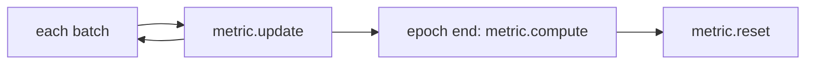

# Evaluation with torchmetrics

Accuracy alone misleads with imbalanced classes, and averaging metrics per batch is subtly wrong (batches differ in size and composition). **torchmetrics** accumulates statistics over all batches and computes the metric once, correctly, also across several GPUs.

```python
import torch
import torchmetrics as tm

torch.manual_seed(0)
num_classes = 3
metrics = tm.MetricCollection({
    "acc": tm.Accuracy(task="multiclass", num_classes=num_classes),
    "f1_macro": tm.F1Score(task="multiclass", num_classes=num_classes, average="macro"),
    "precision": tm.Precision(task="multiclass", num_classes=num_classes, average=None),
    "recall": tm.Recall(task="multiclass", num_classes=num_classes, average=None),
})
confmat = tm.ConfusionMatrix(task="multiclass", num_classes=num_classes)

# an imbalanced problem: class 2 is rare, and the "model" is weak on it
y_true = torch.cat([torch.zeros(500), torch.ones(400), torch.full((100,), 2)]).long()
logits = torch.randn(1000, 3)
logits[torch.arange(1000), y_true] += torch.where(y_true == 2, 0.3, 2.5)   # confident on 0 and 1, not on 2

for i in range(0, 1000, 128):                                            # as if over a DataLoader
    metrics.update(logits[i:i + 128], y_true[i:i + 128])
    confmat.update(logits[i:i + 128], y_true[i:i + 128])
results = metrics.compute()
print({k: v.round(decimals=3).tolist() for k, v in results.items()})
print(confmat.compute())
metrics.reset(); confmat.reset()                                           # before the next epoch
```

Accuracy looks fine; per-class recall shows the rare class is mostly missed. Macro F1 (the average over classes, each counted equally) exposes it in a single number.

## Which metric?

| Situation | Metric |
|---|---|
| balanced classes | accuracy, plus a confusion matrix |
| imbalanced classes | per-class precision and recall, macro F1, PR-AUC |
| ranking or thresholds matter | ROC-AUC, or precision at a chosen recall |
| regression | MAE (in the target's units), RMSE, R² |
| probabilities used for decisions | calibration (do 70% predictions come true 70% of the time?) |



## The test set is for the end

Use the validation set for every decision (model size, learning rate, threshold, early stopping). Evaluate on the test set **once**, at the end. If you look at test results and change something, the test set has become a second validation set and your final number is optimistic.
