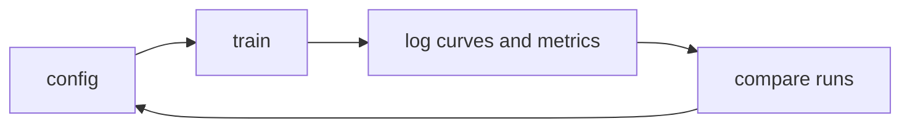

# Experiment tracking and hyperparameter search

After ten runs you won't remember which settings gave which result. Log every run: its settings, its curves, its final metrics and its code version.

## TensorBoard, built in

```python
import torch
from torch import nn
from torch.utils.tensorboard import SummaryWriter

torch.manual_seed(0)
X = torch.randn(512, 20); y = (X[:, :5].sum(1) + torch.randn(512) > 0).long()   # a noisy rule
X_tr, y_tr, X_va, y_va = X[:384], y[:384], X[384:], y[384:]

def run(lr, hidden, log_dir):
    writer = SummaryWriter(log_dir)
    model = nn.Sequential(nn.Linear(20, hidden), nn.ReLU(), nn.Linear(hidden, 2))
    opt = torch.optim.AdamW(model.parameters(), lr=lr)
    for step in range(200):
        loss = nn.functional.cross_entropy(model(X_tr), y_tr)
        opt.zero_grad(); loss.backward(); opt.step()
        writer.add_scalar("train/loss", loss.item(), step)
    with torch.no_grad():
        acc = (model(X_va).argmax(1) == y_va).float().mean().item()     # judged on validation data
    writer.add_hparams({"lr": lr, "hidden": hidden}, {"hparam/accuracy": acc})
    writer.close()
    return acc

print(run(1e-2, 32, "runs/lr1e-2_h32"))
```

Then `tensorboard --logdir runs` opens a dashboard comparing all runs' curves. Hosted tools such as **Weights & Biases** and **MLflow** (open source, self-hostable) add run comparison, artifact storage and team sharing with a few lines of code.

## What to log

- every setting (a `config` dict saved with the run), the random seed, and the git commit;
- train and validation loss and the main metric, per step or epoch;
- the learning rate and gradient norm (early warnings);
- the final checkpoint path and test result.

## Hyperparameter search

```python
import itertools, random

grid = {"lr": [3e-3, 1e-2, 3e-2], "hidden": [16, 64]}
results = []
for lr, hidden in itertools.product(grid["lr"], grid["hidden"]):
    results.append((run(lr, hidden, f"runs/grid_lr{lr}_h{hidden}"), lr, hidden))
print(sorted(results, reverse=True)[:3])

random.seed(0)                                      # random search: often better for the same budget
samples = [(10 ** random.uniform(-3.5, -1), random.choice([16, 32, 64, 128])) for _ in range(4)]
print([f"lr={lr:.1e}, hidden={h}" for lr, h in samples])
```

| Method | When |
|---|---|
| Grid search | 1 or 2 settings, few values |
| **Random search** | more settings; usually finds good values faster than a grid (Bergstra and Bengio, 2012) |
| Bayesian or early-stopping search (Optuna, Ray Tune) | expensive runs; stops bad trials early |

Search learning rate on a log scale (1e-4, 3e-4, 1e-3...), tune the most important setting first (learning rate, then batch size and model size, then regularisation), and judge everything on the validation set.


