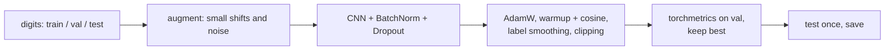

# Project: a strong image classifier, end to end

Combine the whole course on the digits images: a CNN with BatchNorm, augmentation, AdamW with a warmup-cosine schedule, label smoothing, gradient clipping, mixed precision where available, torchmetrics, early stopping and a resumable checkpoint.



```python
import math
import torch
from torch import nn
import torch.nn.functional as F
import torchmetrics as tm
from torch.utils.data import DataLoader, TensorDataset
from sklearn.datasets import load_digits
from sklearn.model_selection import train_test_split

torch.manual_seed(0)
device = "cuda" if torch.cuda.is_available() else "cpu"
d = load_digits()
X = torch.tensor(d.images, dtype=torch.float32).unsqueeze(1) / 16.0
y = torch.tensor(d.target)
X_tmp, X_te, y_tmp, y_te = train_test_split(X, y, test_size=0.2, random_state=0, stratify=y)
X_tr, X_va, y_tr, y_va = train_test_split(X_tmp, y_tmp, test_size=0.2, random_state=0, stratify=y_tmp)

def augment(xb):
    shift = torch.randint(-1, 2, (2,)).tolist()
    xb = torch.roll(xb, shifts=shift, dims=(2, 3))               # move the digit by up to one pixel
    return (xb + 0.05 * torch.randn_like(xb)).clamp(0, 1)

model = nn.Sequential(
    nn.Conv2d(1, 32, 3, padding=1), nn.BatchNorm2d(32), nn.ReLU(),
    nn.Conv2d(32, 32, 3, padding=1), nn.BatchNorm2d(32), nn.ReLU(), nn.MaxPool2d(2),
    nn.Conv2d(32, 64, 3, padding=1), nn.BatchNorm2d(64), nn.ReLU(),
    nn.AdaptiveAvgPool2d(1), nn.Flatten(), nn.Dropout(0.2), nn.Linear(64, 10),
).to(device)

epochs, batch = 25, 64
dl = DataLoader(TensorDataset(X_tr, y_tr), batch_size=batch, shuffle=True, drop_last=True)
total, warmup = epochs * len(dl), len(dl)
opt = torch.optim.AdamW(model.parameters(), lr=3e-3, weight_decay=0.05)
sched = torch.optim.lr_scheduler.LambdaLR(
    opt, lambda s: (s + 1) / warmup if s < warmup else 0.5 * (1 + math.cos(math.pi * (s - warmup) / (total - warmup))))
val_acc = tm.Accuracy(task="multiclass", num_classes=10).to(device)
amp = torch.bfloat16 if device == "cpu" or torch.cuda.is_bf16_supported() else torch.float16
scaler = torch.amp.GradScaler(device, enabled=(amp == torch.float16))

best, best_state, bad = 0.0, None, 0
for epoch in range(epochs):
    model.train()
    for xb, yb in dl:
        xb, yb = augment(xb).to(device), yb.to(device)
        with torch.autocast(device_type=device, dtype=amp):
            loss = F.cross_entropy(model(xb), yb, label_smoothing=0.1)
        opt.zero_grad()
        scaler.scale(loss).backward()
        scaler.unscale_(opt)
        nn.utils.clip_grad_norm_(model.parameters(), 1.0)
        scaler.step(opt); scaler.update(); sched.step()
    model.eval()
    with torch.no_grad():
        val_acc.update(model(X_va.to(device)), y_va.to(device))
    acc = val_acc.compute().item(); val_acc.reset()
    if acc > best:
        best, best_state, bad = acc, {k: v.detach().clone() for k, v in model.state_dict().items()}, 0
    else:
        bad += 1
    if bad >= 6:
        break
model.load_state_dict(best_state)
model.eval()
with torch.no_grad():
    test = (model(X_te.to(device)).argmax(1).cpu() == y_te).float().mean().item()
print(f"best val accuracy {best:.3f}, test accuracy {test:.3f}, stopped after epoch {epoch + 1}")
torch.save({"model": best_state, "classes": list(range(10))}, "digits_cnn.pt")
```

This reaches about 98 to 99% on held-out digits, better than part 1's MLP with fewer parameters.

## Your turn: an ablation

Remove one ingredient at a time (augmentation, label smoothing, the schedule, BatchNorm) and record validation accuracy in a table. An **ablation** like this shows which parts actually help on your data, and it's exactly the kind of evidence interviewers and reviewers want to see.

## Optional videos

The lesson above is complete on its own. These go deeper, if you like learning by watching.

**PyTorch for Deep Learning and Machine Learning, full course (freeCodeCamp.org, Daniel Bourke)**

https://www.youtube.com/watch?v=V_xro1bcAuA
