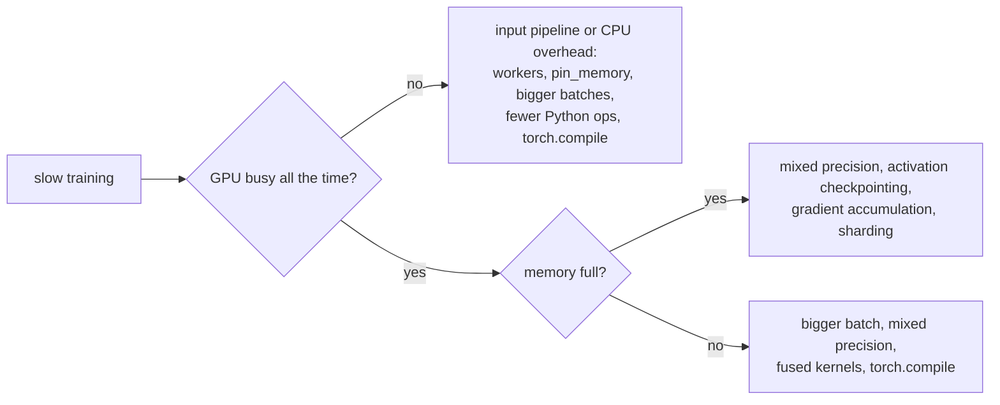

# Measure first: profiling and data loading

"Make training faster" starts with knowing where the time goes. Guessing is usually wrong: the GPU is often waiting for data, or for the CPU to launch thousands of tiny operations.



## Timing correctly

GPU operations run **asynchronously**: Python returns before the GPU finishes. Time with `torch.cuda.synchronize()` around the measured code (on a CPU it isn't needed), and skip the first iterations, which include one-off setup.

```python
import time
import torch
from torch import nn

model = nn.Sequential(nn.Linear(512, 2048), nn.GELU(), nn.Linear(2048, 512))
x = torch.randn(256, 512)

def bench(fn, steps=20, warmup=5):
    for _ in range(warmup):
        fn()
    if torch.cuda.is_available():
        torch.cuda.synchronize()
    t = time.perf_counter()
    for _ in range(steps):
        fn()
    if torch.cuda.is_available():
        torch.cuda.synchronize()
    return (time.perf_counter() - t) / steps * 1000

print(f"forward: {bench(lambda: model(x)):.2f} ms")
with torch.inference_mode():                              # like no_grad, plus extra savings for pure inference
    print(f"forward in inference_mode: {bench(lambda: model(x)):.2f} ms")
```

## The profiler

```python
from torch.profiler import profile, ProfilerActivity, record_function

def train_step():
    with record_function("forward_and_backward"):        # your own label in the trace
        loss = model(x).pow(2).mean()
        loss.backward()

with profile(activities=[ProfilerActivity.CPU], record_shapes=True) as prof:   # add ProfilerActivity.CUDA on a GPU
    for _ in range(3):
        train_step()
print(prof.key_averages().table(sort_by="cpu_time_total", row_limit=6))
```

The table lists which operations take the most time. `prof.export_chrome_trace("trace.json")` writes a timeline you can open in Perfetto (ui.perfetto.dev) to see gaps where the GPU sat idle.

## Feeding the GPU

| Fix | How |
|---|---|
| parallel loading | `DataLoader(num_workers=4 to 8, persistent_workers=True)` |
| faster host-to-GPU copies | `pin_memory=True` and `.to(device, non_blocking=True)` |
| less decoding work | store data pre-processed (resized images, tokenised text) in efficient formats |
| fewer, bigger operations | larger batches; avoid Python loops over items inside `forward` |
| no hidden syncs | avoid `.item()`, `print(tensor)` and `.cpu()` every step; log every N steps |

Every `.item()` forces the CPU to wait for the GPU. Logging the loss every 50 steps instead of every step is a free speed-up.
