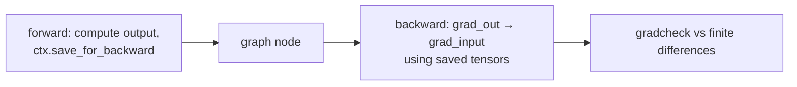

# Custom autograd functions and gradient checks

Autograd covers almost everything. You write your own backward when you need a different gradient than the maths gives (a straight-through estimator for quantisation), a numerically stabler one, or a hand-written kernel.

## torch.autograd.Function

```python
import torch

class ClampSTE(torch.autograd.Function):
    """Forward: clamp to [0, 1]. Backward: pass the gradient straight through (a straight-through estimator)."""

    @staticmethod
    def forward(ctx, x):
        return x.clamp(0, 1)

    @staticmethod
    def backward(ctx, grad_out):
        return grad_out                               # pretend clamp was the identity

x = torch.tensor([-0.5, 0.3, 1.7], requires_grad=True)
ClampSTE.apply(x).sum().backward()
print(x.grad)                                         # tensor([1., 1., 1.]); plain clamp would give [0, 1, 0]
```

A function with a real backward saves what it needs in `ctx`:

```python
class Swish(torch.autograd.Function):
    @staticmethod
    def forward(ctx, x):
        s = torch.sigmoid(x)
        ctx.save_for_backward(x, s)
        return x * s

    @staticmethod
    def backward(ctx, grad_out):
        x, s = ctx.saved_tensors
        return grad_out * (s + x * s * (1 - s))      # d/dx [x·σ(x)]

x = torch.randn(5, dtype=torch.float64, requires_grad=True)
print(torch.autograd.gradcheck(Swish.apply, (x,)))    # True: matches numerical gradients
print(torch.allclose(Swish.apply(x), torch.nn.functional.silu(x)))
```

`gradcheck` compares your backward with finite differences; always run it in `float64` on small inputs. Use it for every custom backward you write.



## Higher-order and functional gradients

`torch.func` (formerly functorch) gives JAX-style transforms: `grad`, `vmap` (vectorise a function over a batch) and `jacrev`/`hessian`.

```python
from torch.func import grad, vmap, hessian

f = lambda w: (w ** 3).sum()
w = torch.tensor([1.0, 2.0])
print(grad(f)(w))                                     # 3w² = [3, 12]
print(hessian(f)(w))                                  # diag(6w) = [[6, 0], [0, 12]]

def loss_one(w, x, y):                                # loss for a single example
    return ((x @ w - y) ** 2)

X, Y = torch.randn(8, 2), torch.randn(8)
per_example_grads = vmap(grad(loss_one), in_dims=(None, 0, 0))(w, X, Y)
print(per_example_grads.shape)                        # (8, 2): one gradient per example, no loop
```

Per-example gradients power techniques like differentially private training and data attribution, which would otherwise need a slow Python loop over the batch.
