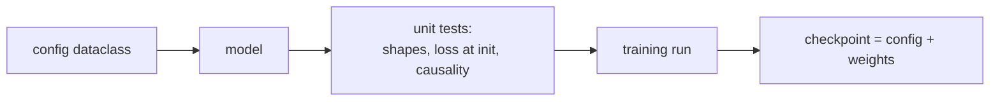

# Writing models the way large codebases do

Big PyTorch projects (nanoGPT, torchtitan, Hugging Face models) share a few conventions that make models configurable, testable and fast.

## 1. A config object

```python
from dataclasses import dataclass, asdict
import torch
from torch import nn
import torch.nn.functional as F

@dataclass
class GPTConfig:
    vocab: int = 256
    ctx: int = 64
    dim: int = 128
    heads: int = 4
    layers: int = 2
    dropout: float = 0.0

class Block(nn.Module):
    def __init__(self, cfg):
        super().__init__()
        self.ln1, self.ln2 = nn.LayerNorm(cfg.dim), nn.LayerNorm(cfg.dim)
        self.qkv, self.proj = nn.Linear(cfg.dim, 3 * cfg.dim), nn.Linear(cfg.dim, cfg.dim)
        self.mlp = nn.Sequential(nn.Linear(cfg.dim, 4 * cfg.dim), nn.GELU(), nn.Linear(4 * cfg.dim, cfg.dim))
        self.heads, self.dropout = cfg.heads, cfg.dropout

    def forward(self, x):
        B, T, C = x.shape
        q, k, v = (t.view(B, T, self.heads, -1).transpose(1, 2) for t in self.qkv(self.ln1(x)).split(C, 2))
        a = F.scaled_dot_product_attention(q, k, v, is_causal=True, dropout_p=self.dropout if self.training else 0.0)
        x = x + self.proj(a.transpose(1, 2).reshape(B, T, C))
        return x + self.mlp(self.ln2(x))

class GPT(nn.Module):
    def __init__(self, cfg: GPTConfig):
        super().__init__()
        self.cfg = cfg
        self.tok, self.pos = nn.Embedding(cfg.vocab, cfg.dim), nn.Embedding(cfg.ctx, cfg.dim)
        self.blocks = nn.ModuleList(Block(cfg) for _ in range(cfg.layers))
        self.ln, self.head = nn.LayerNorm(cfg.dim), nn.Linear(cfg.dim, cfg.vocab, bias=False)
        self.head.weight = self.tok.weight
        self.apply(self._init)

    @staticmethod
    def _init(m):
        if isinstance(m, (nn.Linear, nn.Embedding)):
            nn.init.normal_(m.weight, std=0.02)
        if isinstance(m, nn.Linear) and m.bias is not None:
            nn.init.zeros_(m.bias)

    def forward(self, idx, targets=None):
        x = self.tok(idx) + self.pos(torch.arange(idx.shape[1], device=idx.device))
        for b in self.blocks:
            x = b(x)
        logits = self.head(self.ln(x))
        loss = None if targets is None else F.cross_entropy(logits.flatten(0, 1), targets.flatten())
        return logits, loss

cfg = GPTConfig()
model = GPT(cfg)
print(asdict(cfg), sum(p.numel() for p in model.parameters()))
```

The config is saved with every checkpoint, so a model can always be rebuilt exactly: `torch.save({"cfg": asdict(cfg), "model": model.state_dict()}, path)`.

## 2. Forward returns the loss

Computing the loss inside `forward` when targets are given keeps training loops generic and lets `torch.compile` fuse the loss with the model.

## 3. Tests for models

```python
def test_shapes_and_loss():
    m = GPT(GPTConfig(layers=1))
    idx, targets = torch.randint(0, 256, (2, 16)), torch.randint(0, 256, (2, 16))
    logits, loss = m(idx, targets)
    assert logits.shape == (2, 16, 256)
    assert abs(loss.item() - torch.log(torch.tensor(256.0)).item()) < 0.5   # near ln(vocab) at init

def test_causality():
    m = GPT(GPTConfig(layers=1)).eval()
    a = torch.randint(0, 256, (1, 16)); b = a.clone(); b[0, -1] = (b[0, -1] + 1) % 256
    with torch.no_grad():
        assert torch.allclose(m(a)[0][0, :-1], m(b)[0][0, :-1], atol=1e-5)   # changing the last token can't change earlier outputs

test_shapes_and_loss(); test_causality(); print("tests passed")
```

The causality test catches the most damaging transformer bug (a leaking mask) in milliseconds. Run tests like these with pytest in CI before any long training job.



## Optional videos

The lesson above is complete on its own. These go deeper, if you like learning by watching.

**Let's reproduce GPT-2 (124M) (Andrej Karpathy)**

https://www.youtube.com/watch?v=l8pRSuU81PU
