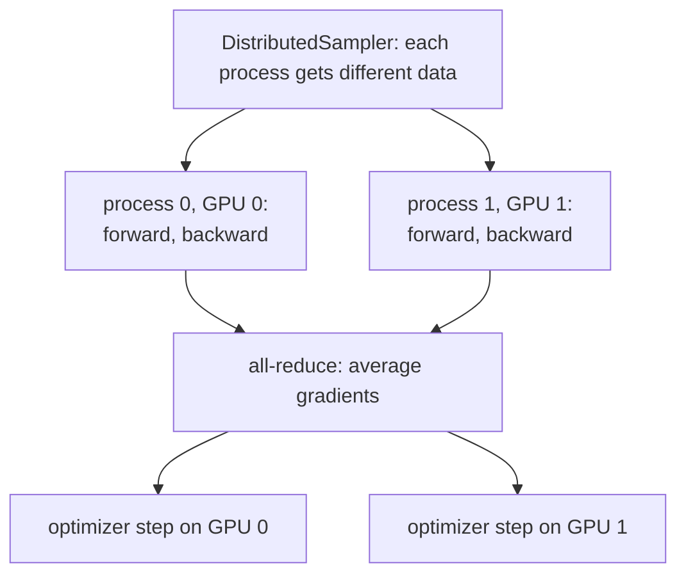

# Distributed training with DDP

One GPU too slow? **Distributed Data Parallel (DDP)** runs one process per GPU. Each holds a full copy of the model, trains on a different slice of every batch, and the gradients are **averaged across processes** (an all-reduce) during `backward()`, so every copy takes the same step.



## The script

The same file runs in every process; `torchrun` starts the processes and sets `RANK`, `LOCAL_RANK` and `WORLD_SIZE`.

```python
# file: ddp_train.py
import os
import torch
import torch.distributed as dist
from torch import nn
from torch.nn.parallel import DistributedDataParallel as DDP
from torch.utils.data import DataLoader, TensorDataset, DistributedSampler

def main():
    use_cuda = torch.cuda.is_available()
    dist.init_process_group(backend="nccl" if use_cuda else "gloo")   # nccl for GPUs, gloo for CPU
    rank, world = dist.get_rank(), dist.get_world_size()
    local_rank = int(os.environ["LOCAL_RANK"])
    device = torch.device(f"cuda:{local_rank}" if use_cuda else "cpu")
    if use_cuda:
        torch.cuda.set_device(device)

    torch.manual_seed(0)                                               # same data and initial weights everywhere
    X = torch.randn(2048, 32); y = (X[:, :4].sum(1) > 0).long()
    ds = TensorDataset(X, y)
    sampler = DistributedSampler(ds, shuffle=True)                     # each rank sees a different shard
    dl = DataLoader(ds, batch_size=64, sampler=sampler)

    model = DDP(nn.Sequential(nn.Linear(32, 64), nn.ReLU(), nn.Linear(64, 2)).to(device),
                device_ids=[local_rank] if use_cuda else None)
    opt = torch.optim.AdamW(model.parameters(), lr=1e-3)

    for epoch in range(3):
        sampler.set_epoch(epoch)                                       # a different shuffle each epoch
        for xb, yb in dl:
            xb, yb = xb.to(device), yb.to(device)
            loss = nn.functional.cross_entropy(model(xb), yb)
            opt.zero_grad(); loss.backward(); opt.step()               # backward averages gradients across ranks
        loss_t = loss.detach().clone()
        dist.all_reduce(loss_t, op=dist.ReduceOp.AVG)                  # average a metric for logging
        if rank == 0:
            print(f"epoch {epoch}: loss {loss_t.item():.3f} on {world} processes, {len(dl)} steps each")

    if rank == 0:
        torch.save(model.module.state_dict(), "ddp_model.pt")          # .module is the unwrapped model; save once
    dist.destroy_process_group()

if __name__ == "__main__":
    main()
```

Run it with two processes (two GPUs, or two CPU processes to test):

```bash
torchrun --standalone --nproc_per_node=2 ddp_train.py
```

## Rules that avoid the classic bugs

- Use a `DistributedSampler` and call `set_epoch` every epoch, or every process trains on the same data.
- The **effective batch size** is per-process batch × number of processes; scale the learning rate (or warmup) accordingly.
- Only **rank 0** prints, logs and saves files.
- Every process must run the same collective operations in the same order, or the job hangs; skipping a step on one rank is a common cause.
- For many machines, `torchrun --nnodes=N --rdzv-endpoint=host:port` adds a rendezvous; clusters usually wrap this in Slurm or Kubernetes.

## Optional videos

The lesson above is complete on its own. These go deeper, if you like learning by watching.

**What is Distributed Data Parallel (DDP) (PyTorch, official)**

https://www.youtube.com/watch?v=Cvdhwx-OBBo
