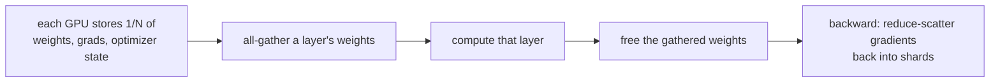

# When the model doesn't fit: FSDP and parallelism

DDP copies the whole model to every GPU. A model with 7 billion parameters trained with AdamW in mixed precision needs roughly 16 bytes per parameter for weights, gradients and optimizer state: over 100 GB, more than one GPU has, before counting activations.

```python
def training_memory_gb(params_billion, bytes_per_param=16):
    # bf16 weights (2) + fp32 master weights (4) + grads (2 to 4) + Adam moments (8), roughly 16 bytes
    return params_billion * 1e9 * bytes_per_param / 1e9

for p in [0.124, 1.3, 7, 70]:
    print(f"{p:>6} B parameters: about {training_memory_gb(p):,.0f} GB before activations")
```

## Sharding with FSDP

**Fully Sharded Data Parallel** splits (shards) weights, gradients and optimizer state across GPUs, so each holds only 1/N of them. Just before a layer runs, its full weights are gathered; right after, they're freed again.



In current PyTorch the API is `fully_shard` (often called FSDP2), applied to each transformer block and then to the whole model:

```python
import inspect
from torch.distributed.fsdp import fully_shard, MixedPrecisionPolicy
print(inspect.signature(fully_shard).parameters.keys())
# inside a torchrun script, after init_process_group:
#   for block in model.blocks:
#       fully_shard(block, mp_policy=MixedPrecisionPolicy(param_dtype=torch.bfloat16))
#   fully_shard(model)
#   optimizer = torch.optim.AdamW(model.parameters(), lr=3e-4)   # create the optimizer after sharding
```

DeepSpeed's ZeRO stages implement the same idea and are common in the Hugging Face ecosystem.

## The other kinds of parallelism

| Kind | Splits | When |
|---|---|---|
| **Data parallel** (DDP) | the batch | the model fits on one GPU |
| **Sharded data parallel** (FSDP, ZeRO) | the batch, plus weights, grads and optimizer state | the model doesn't fit with its optimizer state |
| **Tensor parallel** | each layer's matrices across GPUs | very large layers; needs fast links between GPUs in one machine |
| **Pipeline parallel** | groups of layers onto different GPUs | very deep models across machines |
| **Context / sequence parallel** | long sequences across GPUs | very long contexts |

Frontier models combine several ("3-D" or "4-D" parallelism). PyTorch's **torchtitan** repository shows them working together on Llama-style models.

## Rules of thumb

1. Fits on one GPU? Use one GPU, maximise its use first (mixed precision, `torch.compile`, a good input pipeline).
2. Need more speed and the model fits? DDP.
3. Doesn't fit? FSDP (plus activation checkpointing), then tensor parallel inside a machine for the largest models.
4. Measure throughput (tokens or images per second per GPU) after every change; communication overhead can eat the gains.
