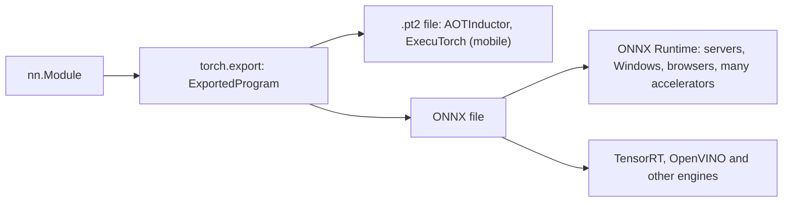

# Exporting models: torch.export and ONNX

Training happens in Python; deployment often doesn't. Exporting turns a model into a **graph** that other runtimes can load without your Python code: a server in C++, a phone, a browser, or a specialised inference engine.



## torch.export

`torch.export.export` traces the model into a clean graph with known input shapes, and fails loudly if something can't be captured (unlike older TorchScript, which is deprecated).

```python
import torch
from torch import nn
from torch.export import export, Dim

class Classifier(nn.Module):
    def __init__(self):
        super().__init__()
        self.net = nn.Sequential(nn.Linear(16, 32), nn.ReLU(), nn.Linear(32, 3))

    def forward(self, x):
        return self.net(x).softmax(-1)

model = Classifier().eval()
example = torch.randn(4, 16)
batch = Dim("batch", min=1, max=1024)                       # allow any batch size in this range
ep = export(model, (example,), dynamic_shapes={"x": {0: batch}})
print(ep.graph_signature.user_inputs, ep.module()(torch.randn(7, 16)).shape)

torch.export.save(ep, "classifier.pt2")
loaded = torch.export.load("classifier.pt2")
print(torch.allclose(loaded.module()(example), model(example)))
```

## ONNX

ONNX is an open format supported by many runtimes and hardware vendors. In current PyTorch, `torch.onnx.export(..., dynamo=True)` builds on `torch.export`:

```python
import numpy as np
import onnxruntime as ort                                   # pip install onnx onnxscript onnxruntime

onnx_program = torch.onnx.export(model, (example,), dynamic_shapes={"x": {0: batch}}, dynamo=True)
onnx_program.save("classifier.onnx")

session = ort.InferenceSession("classifier.onnx", providers=["CPUExecutionProvider"])
name = session.get_inputs()[0].name
x = np.random.randn(5, 16).astype(np.float32)
onnx_out = session.run(None, {name: x})[0]
torch_out = model(torch.from_numpy(x)).detach().numpy()
print(onnx_out.shape, np.abs(onnx_out - torch_out).max() < 1e-5)
```

## The export checklist

- Call `model.eval()` first (dropout and batch norm must be in inference mode).
- Declare **dynamic dimensions** (batch, sequence length) or the graph only accepts the example's exact shape.
- Put preprocessing you want shipped (normalisation, softmax) inside the module.
- **Compare outputs** between PyTorch and the exported model on real inputs, with a tolerance, before shipping.
- Pin versions: the exporting PyTorch and the runtime should be tested together.
