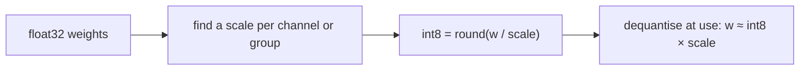

# Making models smaller: quantization and more

Inference cost is mostly memory and bandwidth. Storing weights in fewer bits makes models smaller and often faster.

| Technique | Idea | Typical result |
|---|---|---|
| **Weight-only int8 / int4** | weights stored in 8 or 4 bits, computed in higher precision | 2 to 4 times smaller, little accuracy loss; ideal for LLM inference |
| **Dynamic quantization** | int8 weights, activations quantised on the fly | good for linear-heavy models on CPU |
| **Static quantization** | weights and activations int8, calibrated on sample data | fastest on CPUs and edge chips; needs calibration |
| **Quantization-aware training (QAT)** | simulate quantization during training | best accuracy at very low bits |
| **Pruning** | remove small weights or whole channels | helps when hardware can skip the zeros |
| **Distillation** | train a small model to copy a big one | a smaller architecture with most of the quality |



## Quantization by hand

```python
import torch

torch.manual_seed(0)
w = torch.randn(256, 256)
scale = w.abs().amax(dim=1, keepdim=True) / 127          # one scale per output row (per-channel)
q = torch.clamp(torch.round(w / scale), -127, 127).to(torch.int8)
w_hat = q.float() * scale
print(q.dtype, f"max error {(w - w_hat).abs().max():.4f}, mean error {(w - w_hat).abs().mean():.5f}")
print(f"size: {w.numel() * 4 / 1024:.0f} KB float32 → {q.numel() / 1024:.0f} KB int8 + {scale.numel() * 4 / 1024:.1f} KB scales")
```

## With torchao

The older `torch.ao.quantization` module is deprecated; PyTorch's current quantization library is **torchao** (`pip install torchao`), with one call per recipe:

```python
from torch import nn
from torchao.quantization import quantize_, Int8WeightOnlyConfig

model = nn.Sequential(nn.Linear(256, 512), nn.ReLU(), nn.Linear(512, 10)).eval()
x = torch.randn(8, 256)
ref = model(x)
quantize_(model, Int8WeightOnlyConfig())                  # replaces Linear weights in place
print(type(model[0].weight).__name__, f"max output change {(model(x) - ref).abs().max().item():.4f}")
```

torchao also provides int4 weight-only, float8 training and inference, and QAT recipes, and its quantized models work with `torch.compile`. For LLMs specifically, formats like GGUF (llama.cpp), GPTQ and AWQ are common; the Hugging Face course covers loading them.

## Always measure three things

1. **Quality** on your evaluation set (not just "it still runs").
2. **Latency and throughput** on the real target hardware.
3. **Memory / file size.**

Quantization speeds things up only when the runtime has kernels for that format on that hardware; otherwise you may get a smaller file but no faster model.
