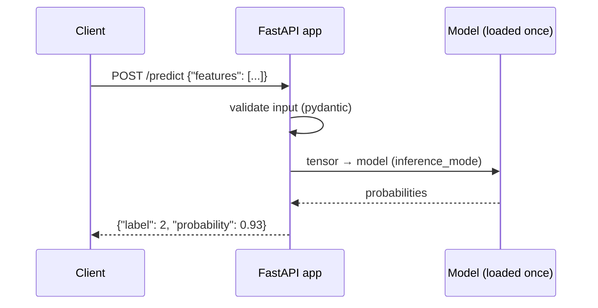

# Serving a model behind an API

A model is useful when other software can call it. The simplest production setup: load the model once at startup and expose it over HTTP with **FastAPI**.



```python
# file: serve.py
from contextlib import asynccontextmanager
import torch
from torch import nn
from fastapi import FastAPI, HTTPException
from pydantic import BaseModel, Field

class Classifier(nn.Module):
    def __init__(self):
        super().__init__()
        self.net = nn.Sequential(nn.Linear(16, 32), nn.ReLU(), nn.Linear(32, 3))
    def forward(self, x):
        return self.net(x)

state = {}

@asynccontextmanager
async def lifespan(app):
    torch.manual_seed(0)
    model = Classifier()              # in a real app: model.load_state_dict(torch.load("model.pt", weights_only=True))
    state["model"] = model.eval()
    yield
    state.clear()

app = FastAPI(lifespan=lifespan)

class Request(BaseModel):
    features: list[float] = Field(min_length=16, max_length=16)

class Response(BaseModel):
    label: int
    probability: float

@app.post("/predict", response_model=Response)
def predict(req: Request):
    x = torch.tensor([req.features], dtype=torch.float32)
    if not torch.isfinite(x).all():
        raise HTTPException(400, "features must be finite numbers")
    with torch.inference_mode():
        probs = state["model"](x).softmax(-1)[0]
    p, label = probs.max(0)
    return Response(label=int(label), probability=round(float(p), 4))

@app.get("/health")
def health():
    return {"ok": "model" in state}
```

Run it with `uvicorn serve:app --port 8000`, then test without a browser:

```python
from fastapi.testclient import TestClient
import serve

with TestClient(serve.app) as client:
    print(client.get("/health").json())
    print(client.post("/predict", json={"features": [0.1] * 16}).json())
    print(client.post("/predict", json={"features": [0.1] * 3}).status_code)    # 422: wrong length
```

## From one request to real traffic

- **Batching:** GPUs are efficient on batches. Inference servers (NVIDIA Triton, TorchServe's successors, Ray Serve, or vLLM for LLMs) collect concurrent requests into batches automatically (dynamic batching).
- **Threads and workers:** set `torch.set_num_threads` on CPU servers to avoid workers fighting over cores; run several worker processes for throughput.
- **Warm up** the model at startup (one dummy call) so the first user doesn't pay compile or allocation costs.
- **Version** the model file and log the version with each prediction.
- **Monitor** latency (p50, p95), error rate and the distribution of inputs and predictions, to catch drift.

## Packaging

A Docker image with a pinned PyTorch version (CPU or CUDA base image), the model file and the app is the usual unit of deployment. Keep the image small: CPU-only wheels for CPU servers, and download large weights at build time rather than at every start.
