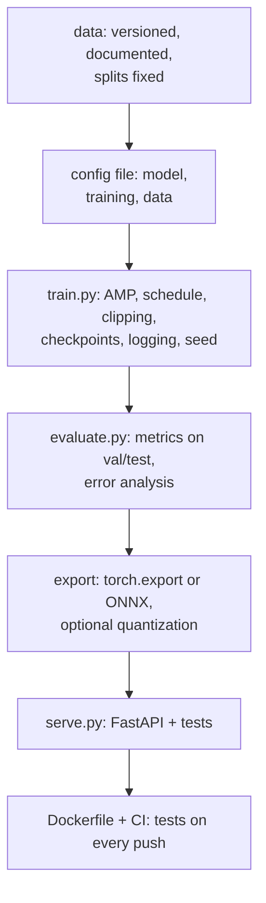

# Capstone: from notebook to production-quality project

You now know every piece. The capstone puts them together the way a professional project looks, so you have something to show and a template for future work.



## The repository

```text
project/
  configs/base.yaml            every setting, nothing hard-coded
  src/project/
    data.py                    Dataset, transforms, splits
    model.py                   model + config dataclass
    train.py                   the training loop (single GPU or torchrun)
    evaluate.py                metrics, confusion matrix, error examples
    export.py                  torch.export / ONNX, output comparison
    serve.py                   FastAPI app
  tests/
    test_model.py              shapes, loss at init, causality or invariances
    test_data.py               no overlap between splits, label ranges
    test_serve.py              API contract with TestClient
  Dockerfile
  README.md                    results table, how to reproduce, limitations
```

## A test that guards your splits

```python
import torch

def check_no_leakage(train_ids, val_ids, test_ids):
    a, b, c = set(train_ids), set(val_ids), set(test_ids)
    assert not (a & b) and not (a & c) and not (b & c), "the same example appears in two splits"

ids = torch.randperm(1000).tolist()
check_no_leakage(ids[:800], ids[800:900], ids[900:])
print("splits are disjoint")
```

## The README results table

| Model | Params | Val accuracy | Test accuracy | Latency (CPU, batch 1) | Size |
|---|---|---|---|---|---|
| baseline (logistic regression) | | | | | |
| your model, float32 | | | | | |
| your model, int8 | | | | | |

Fill every cell with your measured numbers; a reviewer trusts a table with a baseline and an honest limitation far more than a single impressive number.

## Ideas for the capstone

- **Images:** a classifier for something you care about (plant diseases, local currency notes, product defects), with transfer learning, an exported ONNX model and an API.
- **Text:** a small GPT on a corpus you choose (lesson 2 of module 2 as a starting point), trained with DDP on two GPUs on a free or cheap cloud machine.
- **Time series:** a forecaster for public data (electricity, weather, transport), with a proper time-based split and a seasonal-naive baseline.

## Where to go next

- The **Hugging Face and ecosystem** course in this series: pretrained transformers, fine-tuning with PEFT, Lightning, ONNX Runtime.
- The **Karpathy course** in this library: build GPT and its tokenizer from scratch.
- PyTorch's own repositories show professional-scale code: **torchtitan** (large-scale pretraining), **torchtune** (fine-tuning recipes) and **gpt-fast** (fast inference in a few hundred lines).
