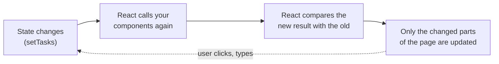

# React's idea, and your first app

Building a web page by hand means **changing the page step by step**: find this element, change its text, add a class, remove that row. With many changes, the page and your data drift apart, and bugs follow.

React flips it: you describe **what the page should look like for the current data**, and React works out the changes.

```
UI = f(state)
```

When the data (state) changes, React calls your function again and updates only what changed on the page.




## Components

A **component** is a function that returns what to show. Its name starts with a capital letter.

```tsx
function Hello() {
  return <h1>Hello, learner!</h1>;
}
```

That HTML-like syntax is **JSX**. It turns into normal function calls. Differences from HTML you'll hit at once:

| HTML | JSX |
|---|---|
| `class="card"` | `className="card"` |
| `for="email"` | `htmlFor="email"` |
| `onclick="..."` | `onClick={handleClick}` |
| `style="color: red"` | `style={{ color: "red" }}` |
| `<br>` | `<br />` (every tag must close) |

Inside `{ }` you can put **any JavaScript expression**:

```tsx
const minutes = 25;
return <p>Today: {minutes} minutes ({minutes / 60} hours)</p>;
```

## Create a project with Vite

You need Node.js (version 20 or newer). Then:

```bash
npm create vite@latest study-tasks -- --template react-ts
cd study-tasks
npm install
npm run dev
```

Open the address it prints (usually `http://localhost:5173`). Edit `src/App.tsx`, save, and the page updates instantly.

What you got:

```
study-tasks/
  index.html          the one HTML page
  src/main.tsx        starts React and puts <App /> into the page
  src/App.tsx         your first component
  package.json        scripts and libraries
  tsconfig.json       TypeScript settings
  vite.config.ts      the build tool's settings
```

## Props: passing data into a component

Components take **props**, like function arguments. With TypeScript you describe them with a type:

```tsx
type TaskItemProps = {
  title: string;
  minutes: number;
  done?: boolean;
};

function TaskItem({ title, minutes, done = false }: TaskItemProps) {
  return (
    <li className={done ? "done" : ""}>
      {title} <small>{minutes} min</small>
    </li>
  );
}

export default function App() {
  return (
    <ul>
      <TaskItem title="Read lesson 1" minutes={25} done />
      <TaskItem title="Practice TypeScript" minutes={40} />
    </ul>
  );
}
```

Forget `minutes` and the editor underlines it straight away. That's TypeScript and React working together.

**Props are read-only.** A component never changes its own props. If something needs to change, that's state (Day 3).

## Children

Whatever you put between a component's tags arrives as `children`:

```tsx
function Card({ title, children }: { title: string; children: React.ReactNode }) {
  return <section className="card"><h2>{title}</h2>{children}</section>;
}

<Card title="Today"><p>Two lessons left.</p></Card>
```

## Thinking in components

Look at any app screen and draw boxes around pieces that repeat or have one job: a header, a task row, a filter bar, a progress bar. Each box is a component. Small components with clear props are easy to read, test and reuse.

## Optional videos

The lesson above is complete on its own. These go deeper, if you like learning by watching.

**React Tutorial for Beginners (Programming with Mosh), uses TypeScript**

https://www.youtube.com/watch?v=SqcY0GlETPk

**React Course, Beginner's Tutorial (freeCodeCamp.org, Bob Ziroll)**

https://www.youtube.com/watch?v=bMknfKXIFA8
