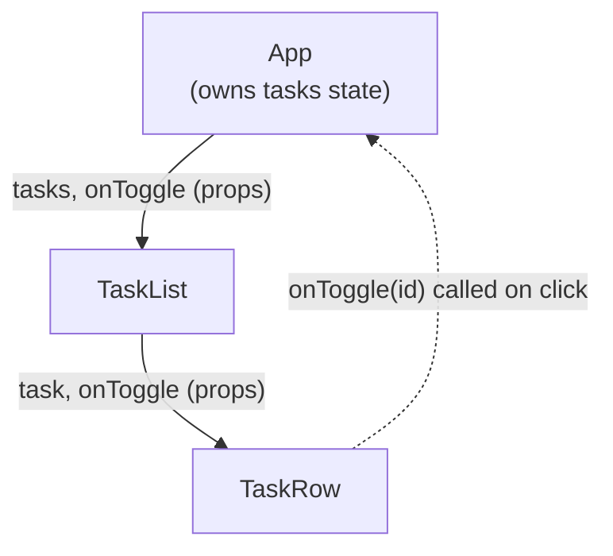

# Lists, conditions and events

## Showing a list

Use `map` to turn data into elements:

```tsx
type Task = { id: number; title: string; done: boolean };

const tasks: Task[] = [
  { id: 1, title: "Read lesson 1", done: true },
  { id: 2, title: "Do the quiz", done: false },
];

function TaskList() {
  return (
    <ul>
      {tasks.map((t) => (
        <li key={t.id}>{t.title}</li>
      ))}
    </ul>
  );
}
```

### Keys

Every item in a list needs a **`key`** that is unique among its siblings and **stays the same** for that item. React uses it to know which row is which when the list changes.

- ✅ A database id: `key={t.id}`
- ❌ The array index: `key={i}`. If you delete or reorder rows, React mixes up which row has which state (a checked box jumps to the wrong task).

## Showing things conditionally

```tsx
{tasks.length === 0 && <p>No tasks yet. Add one!</p>}

{loading ? <Spinner /> : <TaskList />}

{task.due && <small>Due {task.due}</small>}
```

One trap: `{count && <Badge />}` shows a **0** on the page when `count` is 0. Write `{count > 0 && <Badge />}`.

For bigger choices, return early:

```tsx
function Status({ load }: { load: Load }) {
  if (load.state === "loading") return <p>Loading…</p>;
  if (load.state === "error") return <p role="alert">{load.message}</p>;
  return <TaskList tasks={load.tasks} />;
}
```

That's the union type from Day 1 doing real work: TypeScript knows `load.tasks` exists only in the last line.

## Events

```tsx
function DeleteButton({ onDelete }: { onDelete: () => void }) {
  return <button onClick={onDelete}>Delete</button>;
}
```

Pass the **function**, don't call it: `onClick={onDelete}`, not `onClick={onDelete()}` (that would run it during rendering).

If you need an argument, wrap it:

```tsx
<button onClick={() => remove(task.id)}>Delete</button>
```

### Typing events

Usually TypeScript infers the event for you when you write the handler inline. When you write it separately:

```tsx
function handleChange(e: React.ChangeEvent<HTMLInputElement>) {
  console.log(e.target.value);
}

function handleSubmit(e: React.FormEvent<HTMLFormElement>) {
  e.preventDefault();          // stop the page from reloading
}
```

Tip: hover over `onChange` in your editor and it shows the exact type to use.

## Passing actions down

Children don't change the parent's data. They **ask** the parent through a function prop:

```tsx
type RowProps = { task: Task; onToggle: (id: number) => void };

function TaskRow({ task, onToggle }: RowProps) {
  return (
    <li>
      <label>
        <input type="checkbox" checked={task.done} onChange={() => onToggle(task.id)} />
        {task.title}
      </label>
    </li>
  );
}
```

Data goes **down** through props; requests go **up** through callbacks. This one-way flow is why React apps stay understandable as they grow.




## Styling

For this course, plain CSS is enough: import a file (`import "./App.css"`) and use `className`. Later you can try CSS Modules (`Card.module.css`, built into Vite) or Tailwind. Whatever you pick, use real `<button>`, `<label>` and `<input>` elements: they're accessible for free.
