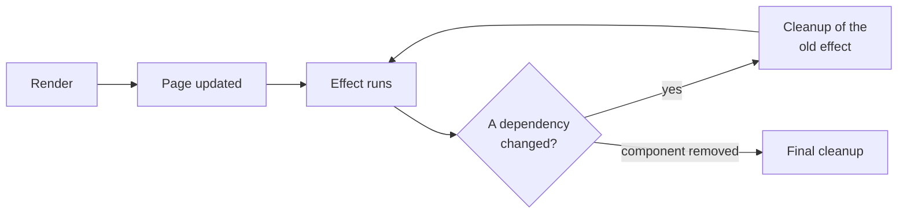

# Effects and loading data

Rendering must be **pure**: given the same props and state, a component returns the same output and changes nothing outside itself. But apps also need to **do** things: fetch data, start timers, save to `localStorage`, set the page title. Those are **effects**.

## `useEffect`

```tsx
useEffect(() => {
  document.title = `${remaining} tasks left`;
}, [remaining]);
```

- The function runs **after** React updates the page.
- The array is the **dependencies**: the effect runs again only when one of them changes.
  - `[remaining]`: when `remaining` changes.
  - `[]`: once, after the first render.
  - No array: after every render (rarely what you want).

List **every** value from the component that the effect uses. The ESLint rule `react-hooks/exhaustive-deps` (on by default in Vite's template) warns you when you forget one.




## Cleanup

If an effect starts something, return a function that stops it:

```tsx
useEffect(() => {
  const id = setInterval(() => setSeconds(s => s + 1), 1000);
  return () => clearInterval(id);   // runs before the next effect and when the component goes away
}, []);
```

In development, React runs effects **twice** on purpose (Strict Mode) to show you missing cleanups. If something breaks when it runs twice, the cleanup is missing.

## Fetching data, done properly

```tsx
type Load =
  | { state: "loading" }
  | { state: "error"; message: string }
  | { state: "ready"; tasks: Task[] };

function Tasks() {
  const [load, setLoad] = useState<Load>({ state: "loading" });

  useEffect(() => {
    const ctrl = new AbortController();
    fetch("/tasks.json", { signal: ctrl.signal })
      .then((res) => {
        if (!res.ok) throw new Error(`HTTP ${res.status}`);
        return res.json() as Promise<Task[]>;
      })
      .then((tasks) => setLoad({ state: "ready", tasks }))
      .catch((err) => {
        if (err.name !== "AbortError") setLoad({ state: "error", message: String(err.message) });
      });
    return () => ctrl.abort();    // the component left: cancel the request
  }, []);

  if (load.state === "loading") return <p>Loading…</p>;
  if (load.state === "error") return <p role="alert">Couldn't load tasks: {load.message}</p>;
  return <TaskList tasks={load.tasks} />;
}
```

Three things every data fetch needs: a **loading** state, an **error** state the user can understand, and **cancelling** when it's no longer needed (otherwise a slow old answer can overwrite a newer one).

Try it: put a `tasks.json` file in the `public/` folder of your Vite app and fetch `/tasks.json`.

## You might not need an effect

Effects are for talking to things **outside React**. Common misuse:

```tsx
// ❌ an effect to calculate something
const [visible, setVisible] = useState<Task[]>([]);
useEffect(() => setVisible(tasks.filter(t => !t.done)), [tasks]);

// ✅ just calculate it while rendering
const visible = tasks.filter(t => !t.done);
```

```tsx
// ❌ an effect to react to a click
useEffect(() => { if (submitted) save(); }, [submitted]);

// ✅ do it in the event handler
function handleSubmit() { save(); }
```

If it happens **because the user did something**, put it in the event handler. If it happens **because the component is on screen**, an effect may be right.

## Real projects

For serious data loading (caching, retries, refreshing), most teams use a library such as **TanStack Query**, which handles everything above for you. Learn the manual way first so you know what it does.
