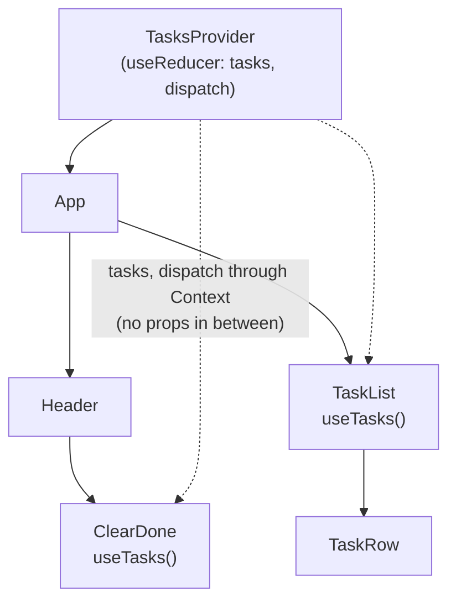

# Shared state: Context and useReducer

When many components across the app need the same data (the signed-in user, the theme, the task list), passing props through every level gets tiring ("prop drilling"). **Context** makes a value available to everything inside a provider.

## useReducer: all the changes in one place

As state logic grows, a **reducer** keeps every kind of change together and easy to test:

```tsx
type Action =
  | { type: "add"; title: string }
  | { type: "toggle"; id: number }
  | { type: "remove"; id: number }
  | { type: "clearDone" };

function tasksReducer(tasks: Task[], action: Action): Task[] {
  switch (action.type) {
    case "add":
      return [...tasks, { id: Date.now(), title: action.title, done: false }];
    case "toggle":
      return tasks.map((t) => (t.id === action.id ? { ...t, done: !t.done } : t));
    case "remove":
      return tasks.filter((t) => t.id !== action.id);
    case "clearDone":
      return tasks.filter((t) => !t.done);
  }
}

const [tasks, dispatch] = useReducer(tasksReducer, []);
dispatch({ type: "toggle", id: 3 });
```

Why it's nice with TypeScript: the `Action` union means a typo like `{ type: "toggel" }` is an error, and inside each `case` TypeScript knows exactly which fields exist. A reducer is a **plain function**, so you can test it without React at all.

## Context: share it with the whole app

```tsx
// tasks-context.tsx
import { createContext, useContext, useReducer, type ReactNode, type Dispatch } from "react";

type TasksValue = { tasks: Task[]; dispatch: Dispatch<Action> };
const TasksContext = createContext<TasksValue | null>(null);

export function TasksProvider({ children }: { children: ReactNode }) {
  const [tasks, dispatch] = useReducer(tasksReducer, []);
  return <TasksContext.Provider value={{ tasks, dispatch }}>{children}</TasksContext.Provider>;
}

export function useTasks() {
  const v = useContext(TasksContext);
  if (!v) throw new Error("useTasks must be used inside <TasksProvider>");
  return v;
}
```

Wrap the app once:




```tsx
<TasksProvider>
  <App />
</TasksProvider>
```

Then any component, however deep:

```tsx
function ClearDone() {
  const { tasks, dispatch } = useTasks();
  const n = tasks.filter((t) => t.done).length;
  return <button disabled={!n} onClick={() => dispatch({ type: "clearDone" })}>Clear {n} done</button>;
}
```

The `null` default plus the check in `useTasks` gives a clear error if someone forgets the provider, and lets TypeScript know the value is never `null` after that.

## When to use what

| Situation | Use |
|---|---|
| One component's own data (an input, a toggle) | `useState` |
| Several related changes to the same data | `useReducer` |
| Two or three nearby components | Lift state up and pass props |
| Many components far apart (theme, user, cart) | Context (often with a reducer) |
| Data from a server, with caching | A data library like TanStack Query |
| Very large apps with lots of shared state | Zustand or Redux Toolkit |

Context isn't free: every component that reads it re-renders when its value changes. Keep contexts focused (one for tasks, one for the theme) instead of one giant "everything" context.

## Combine with yesterday's hook

Save the reducer's state to storage by initializing from it and writing in an effect:

```tsx
const [tasks, dispatch] = useReducer(tasksReducer, [], () => {
  try { return JSON.parse(localStorage.getItem("study-tasks") ?? "[]"); } catch { return []; }
});
useEffect(() => localStorage.setItem("study-tasks", JSON.stringify(tasks)), [tasks]);
```
