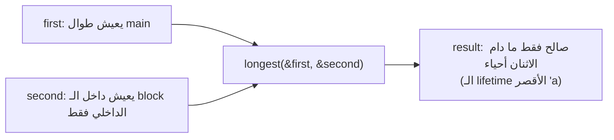

# lifetimes

هذا الكورس يكمل من *Rust للمبتدئين*. يجب أن تكون مرتاحًا مع الـ ownership والـ borrowing والـ structs والـ enums و`Result` والـ traits.

**lifetime** هي جزء الكود الذي يكون فيه الـ reference صالحًا. وborrow checker كان يتتبع lifetimes طوال الوقت؛ وفي أغلب الأحيان يستنتجها بصمت. وهذا الدرس يغطي الحالات التي يجب أن تكتبها فيها.

## المشكلة التي تحلها lifetimes

<!-- diagram -->


```rust
fn longest(a: &str, b: &str) -> &str {      // error: missing lifetime specifier
    if a.len() >= b.len() { a } else { b }
}
```

الـ reference الـ reference يشير إما إلى `a` أو إلى `b`. والـ compiler يحتاج أن يعرف إلى متى تظل النتيجة صالحة، لكي يتحقق من كل مستدعٍ. وتخبره بذلك بمعامل فترة حياة:

```rust
fn longest<'a>(a: &'a str, b: &'a str) -> &'a str {
    if a.len() >= b.len() { a } else { b }
}

fn main() {
    let first = String::from("pyramids");
    let result;
    {
        let second = String::from("nile");
        result = longest(&first, &second);
        println!("{result}");
    }
    // println!("{result}");   // error: `second` does not live long enough
}
```

```output
pyramids
```

‏`'a` (تُقرأ "tick a") اسم لـ "منطقة ما من الكود". والتوقيع يقول: **النتيجة تعيش على الأكثر بقدر أقصر الاثنين a وb**. واستخدام `result` بعد أن تنتهي `second` غير آمن، حتى لو كانت هذه المرة تشير إلى `first`، فيرفضه الـ compiler.

lifetimes لا تغيّر أبدًا مدة حياة أي شيء. إنها فقط **تصف** العلاقات لكي يستطيع الـ compiler التحقق منها.

## الحذف (Elision): متى لا تكتبها

كتبت functions كثيرة ترجع references بدون فترات حياة. والـ compiler يملؤها بثلاث قواعد ("elision"):

1. كل معامل reference يأخذ فترة حياة خاصة به.
2. لو كان هناك معامل reference واحد بالضبط، يأخذ المخرج فترة حياته.
3. لو كان أحد المعاملات `&self` أو `&mut self`، يأخذ المخرج فترة حياة self.

إذن `fn first_word(s: &str) -> &str` هي في الحقيقة `fn first_word<'a>(s: &'a str) -> &'a str`. ولا تكتب lifetimes إلا عندما لا تستطيع هذه القواعد الحسم، كما في `longest`.

## ‏Structs تحمل references

الـ struct الذي يحمل reference يحتاج فترة حياة، لكي لا يعيش أطول من البيانات:

```rust
struct Highlight<'a> {
    text: &'a str,
    start: usize,
}

impl<'a> Highlight<'a> {
    fn word(&self) -> &'a str {
        let rest = &self.text[self.start..];
        rest.split_whitespace().next().unwrap_or("")
    }
}

fn main() {
    let article = String::from("Rust makes systems programming safer");
    let h = Highlight { text: &article, start: 11 };
    println!("highlighted: {}", h.word());
}
```

```output
highlighted: systems
```

‏`Highlight<'a>` تُقرأ: "الـ Highlight لا يمكن أن يعيش أطول من النص الذي يشير إليه". والمحللات (parsers) غالبًا تبدو هكذا: تحمل slices من المدخلات بدل نسخها، وهذا يجعلها سريعة جدًا.

## ‏'static

‏`'static` معناها "صالح طوال عمر البرنامج". والنصوص الحرفية من النوع `&'static str`: فهي مكتوبة داخل ملف البرنامج.

```rust
fn level_name(n: u8) -> &'static str {
    match n {
        0 => "beginner",
        1 => "intermediate",
        _ => "advanced",
    }
}

fn main() {
    println!("{}", level_name(1));
}
```

```output
intermediate
```

عندما يقترح الـ compiler إضافة `'static` لإصلاح خطأ، فكّر مرتين. غالبًا تكون صحيحة للنصوص الحرفية وللبيانات المنقولة إلى الـ threads، وغالبًا تكون خطأ كإصلاح سريع لمشكلة borrowing. والإصلاح الحقيقي في أحيان كثيرة أن ترجع `String` مملوكة بدل reference.

## عندما تتعبك lifetimes، امتلك البيانات

لو أصبح struct بفترات حياة مؤلمًا (تريد تخزينه، أو إرجاعه، أو إرساله إلى thread)، فاجعله يملك بياناته: `String` بدل `&str`، و`Vec<T>` بدل `&[T]`. نسخ القليل من البيانات رخيص؛ وlifetimes تستحق العناء غالبًا في المسارات الحساسة للسرعة مثل المحللات.

## الخلاصة

- lifetimes تسمّي مدة صلاحية الـ references؛ إنها تصف ولا تغيّر شيئًا.
- قواعد الحذف تملؤها لأغلب الـ functions؛ واكتب `<'a>` عندما قد تستعير النتيجة من عدة مدخلات.
- الـ structs التي تحمل references تحتاج معاملات فترات حياة؛ وامتلاك البيانات غالبًا أبسط.

## فيديوهات اختيارية

الدرس أعلاه كامل وحده. هذه الفيديوهات للتعمق إن كنت تحب التعلم بالمشاهدة. الفيديوهات المكتوب بجانبها (بالإنجليزية) يمكنك تشغيل الترجمة لها (**CC**)، ثم **الإعدادات ← الترجمة ← ترجمة تلقائية ← العربية**.

**Crust of Rust: Lifetime annotations (Jon Gjengset) (بالإنجليزية)**

https://www.youtube.com/watch?v=rAl-9HwD858
