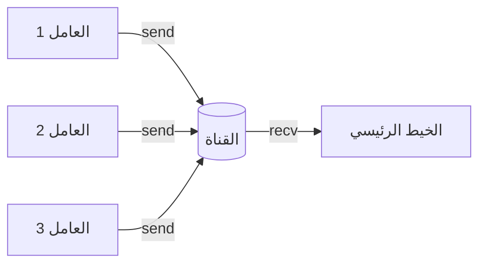

# الـ threads والـ channels والحالة المشتركة

شعار Rust هنا هو **الـ concurrency بلا خوف**: نفس قواعد الـ ownership والـ borrowing التي تمنع أخطاء الذاكرة تمنع أيضًا data races. لو تُرجم برنامجك متعدد الـ threads، فليس فيه data races.

## تشغيل الـ threads

```rust
use std::thread;

fn main() {
    let handles: Vec<_> = (1..=3)
        .map(|id| {
            thread::spawn(move || {
                let sum: u64 = (1..=id * 1000).sum();
                (id, sum)
            })
        })
        .collect();

    for h in handles {
        let (id, sum) = h.join().unwrap();      // wait and take the thread's result
        println!("thread {id}: {sum}");
    }
}
```

```output
thread 1: 500500
thread 2: 2001000
thread 3: 4501500
```

- `thread::spawn` تشغّل closure على thread جديد وترجع مقبضًا.
- `move` إجبارية: قد يعيش الـ thread أطول من الـ function الحالية، فيجب أن يملك ما يستخدمه.
- `join()` تنتظر الـ thread وترجع نتيجته (`Err` لو أصابه panic).

## الـ threads ذات النطاق: استعر بدل أن تنقل

عندما تحتاج الـ threads فقط **borrowing** بيانات محلية، تضمن `thread::scope` أنها تنتهي قبل نهاية النطاق، فتكون الـ borrowing آمنة:

```rust
use std::thread;

fn main() {
    let data: Vec<u32> = (1..=100).collect();
    let (left, right) = data.split_at(50);

    let (a, b) = thread::scope(|s| {
        let h1 = s.spawn(|| left.iter().sum::<u32>());
        let h2 = s.spawn(|| right.iter().sum::<u32>());
        (h1.join().unwrap(), h2.join().unwrap())
    });
    println!("{a} + {b} = {}", a + b);
}
```

```output
1275 + 3775 = 5050
```

لا `move`، ولا `Arc`، ولا نسخ: الـ compiler يعرف أن الـ threads تنتهي قبل `data`.

## الـ channels: إرسال رسائل بين الـ threads

الـ channel طابور: المنتجون يرسلون، ومستهلك واحد يستقبل. وownership كل رسالة تنتقل عبر الـ channel، فلا شيء مشترك أصلًا.



```rust
use std::sync::mpsc;
use std::thread;

fn main() {
    let (tx, rx) = mpsc::channel();
    for id in 1..=3 {
        let tx = tx.clone();                    // each worker gets its own sender
        thread::spawn(move || {
            let result = id * id;
            tx.send((id, result)).unwrap();
        });
    }
    drop(tx);                                    // close our copy so the loop below can end

    let mut results: Vec<(i32, i32)> = rx.iter().collect();   // ends when all senders are gone
    results.sort();
    println!("{:?}", results);
}
```

```output
[(1, 1), (2, 4), (3, 9)]
```

‏`mpsc` معناها "منتجون متعددون، ومستهلك واحد". وloop الاستقبال تنتهي عندما يُسقط كل مرسل. والنتائج تصل بأي ترتيب تنتهي به الـ threads، فرتّب لو كان الترتيب مهمًا.

## الحالة المشتركة: ‏Arc<Mutex<T>>

عندما يجب أن تغيّر الـ threads فعلًا نفس البيانات، اجمع:

- `Arc<T>`: مثل `Rc`، لكن عدّاده آمن عبر الـ threads ("عدّ references ذري")
- `Mutex<T>`: thread واحد في كل مرة يستطيع الوصول إلى البيانات بداخله

```rust
use std::collections::HashMap;
use std::sync::{Arc, Mutex};
use std::thread;

fn main() {
    let counts = Arc::new(Mutex::new(HashMap::new()));
    let texts = ["red green red", "green blue", "red blue blue"];

    let handles: Vec<_> = texts
        .iter()
        .map(|&text| {
            let counts = Arc::clone(&counts);
            thread::spawn(move || {
                for w in text.split_whitespace() {
                    let mut map = counts.lock().unwrap();   // locked until `map` is dropped
                    *map.entry(w.to_string()).or_insert(0) += 1;
                }
            })
        })
        .collect();
    for h in handles {
        h.join().unwrap();
    }

    let map = counts.lock().unwrap();
    let mut pairs: Vec<_> = map.iter().collect();
    pairs.sort();
    println!("{:?}", pairs);
}
```

```output
[("blue", 3), ("green", 2), ("red", 3)]
```

لاحظ أنه لا توجد طريقة للوصول إلى الـ HashMap **بدون** lock: البيانات تعيش داخل الـ Mutex. في C++ قد تنسى الـ lock؛ وفي Rust لا يمكنك ذلك. والـ lock يُفك تلقائيًا عندما يخرج الحارس من نطاقه.

لعدّاد واحد أو علامة، `std::sync::atomic::AtomicUsize` (وأخواتها) أخف من mutex. وللبيانات التي تُقرأ كثيرًا وتُكتب نادرًا، يسمح `RwLock` بقرّاء كثيرين في نفس الوقت.

## ‏Send وSync: كيف يعرف الـ compiler

traitان علاميان يجعلان هذا آمنًا:

- `Send`: يمكن **نقل** القيمة إلى thread آخر.
- `Sync`: يمكن **مشاركة** القيمة بالـ reference بين الـ threads.

الـ compiler يستنتجهما تلقائيًا. و`Rc` ليس أيًا منهما (عدّاده غير آمن للـ threads)، فهذا لا يُترجم:

```rust
let data = std::rc::Rc::new(5);
std::thread::spawn(move || println!("{data}"));
// error: `Rc<i32>` cannot be sent between threads safely
```

استبدل `Rc` بـ `Arc` فيعمل. ونادرًا ما تكتب هذين الـ traitين بنفسك؛ فقط تقرأ الخطأ وتختار النوع الآمن للـ threads.

## الخلاصة

- `thread::spawn(move || ...)` و`join()`؛ و`thread::scope` تسمح للـ threads بborrowing البيانات المحلية.
- الـ channels تنقل الرسائل بين الـ threads: لا مشاركة ولا locks.
- `Arc<Mutex<T>>` للبيانات المشتركة القابلة للتغيير؛ و`Send` و`Sync` تجعلان الـ compiler يستبعد data races.

## فيديوهات اختيارية

الدرس أعلاه كامل وحده. هذه الفيديوهات للتعمق إن كنت تحب التعلم بالمشاهدة. الفيديوهات المكتوب بجانبها (بالإنجليزية) يمكنك تشغيل الترجمة لها (**CC**)، ثم **الإعدادات ← الترجمة ← ترجمة تلقائية ← العربية**.

**Concurrency in Rust: creating threads (Let's Get Rusty) (بالإنجليزية)**

https://www.youtube.com/watch?v=06WcsNPUNC8

**Crust of Rust: Channels (Jon Gjengset) (بالإنجليزية)**

https://www.youtube.com/watch?v=b4mS5UPHh20

**Crust of Rust: Send, Sync, and their implementors (Jon Gjengset) (بالإنجليزية)**

https://www.youtube.com/watch?v=yOezcP-XaIw
